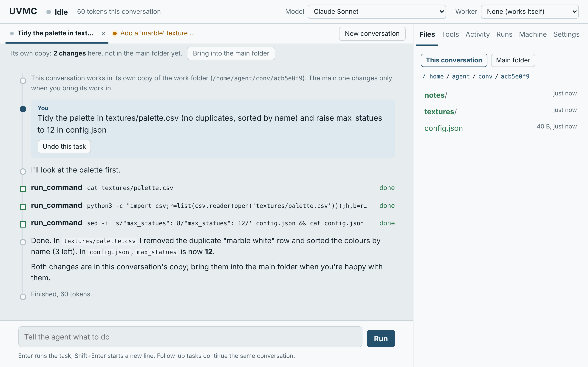
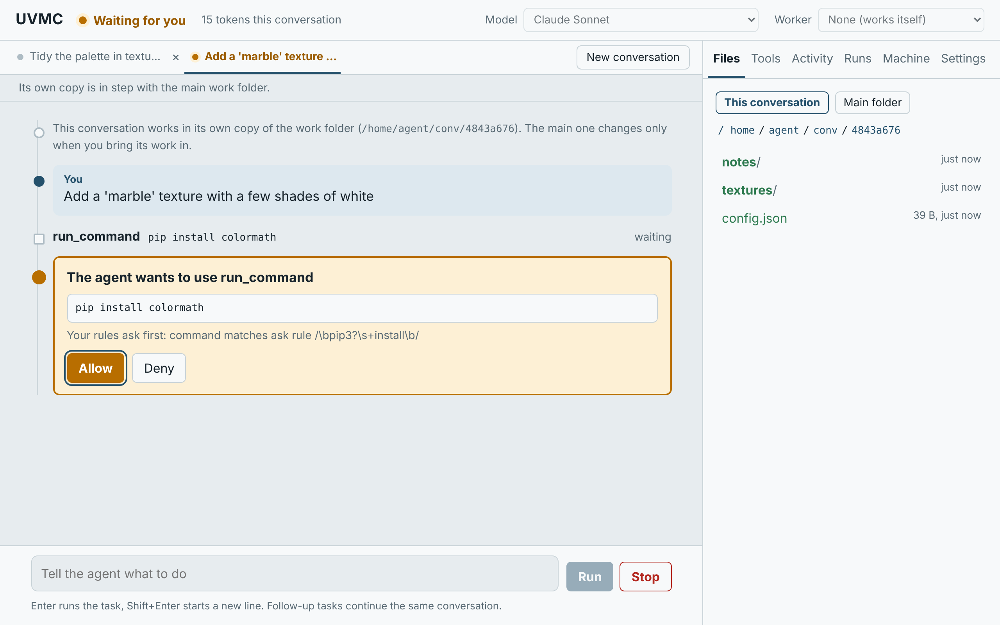
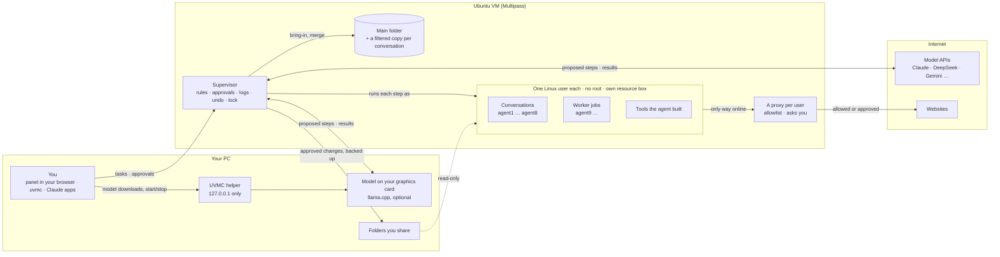

# UVMC

**A supervised Ubuntu workspace for AI agents: the agent gets a computer of its own, you keep the keys.**

UVMC runs an Ubuntu virtual machine on your PC ([Multipass](https://canonical.com/multipass)) in which AI agents run commands, write code, edit files and build small tools for you. The model never touches the machine directly: it proposes each action, a supervisor checks it against your rules (allow, ask you, or refuse), runs it as an unprivileged Linux user, and logs it. You follow every step live in a web control panel, approve what matters, and can stop or undo any task.



## Contents

- [Key features](#key-features)
- [All features](#all-features)
- [How it works](#how-it-works)
- [Requirements](#requirements)
- [Installation](#installation)
- [Getting started](#getting-started)
- [Command reference](#command-reference)
- [Configuration](#configuration)
- [Development](#development)
- [Project status](#project-status)
- [License](#license)

## Key features

- **Full oversight.** Every step appears live in the panel; risky actions wait for your approval; **Stop** and **Undo** at any moment.
- **Isolation enforced by Linux.** No root, a firewall, a proxy and resource limits, and a separate Linux user for every conversation, job and tool.
- **Tools the agent builds.** Ask for something that keeps running (*"every morning, check this page and note what changed"*); the agent writes, tests and proposes it, and once you approve it, it runs on its own and reports to you.
- **A headless browser, preconfigured.** [Playwright](https://playwright.dev) with Chromium, ready for agents and their tools.
- **Any model, including one on your own graphics card.** Claude (API or your plan), any OpenAI-compatible service, or a local model through [llama.cpp](https://github.com/ggml-org/llama.cpp) with no account or subscription.
- **Privacy by design.** Privacy levels per model and file, private conversations that leave nothing behind, and a lock against every program on your PC.
- **Several agents in parallel.** Side-by-side conversations that merge their work, and a coordinator that hands jobs to workers.



## All features

### Running and supervising the agent

| Feature | Description | Guide |
| --- | --- | --- |
| A real machine | An Ubuntu 24.04 VM. The agent installs Python and npm packages (in a venv), runs servers and scripts, and keeps files between tasks. | [Driving the agent](docs/guide.md#driving-the-agent) |
| Live timeline | Messages, tool calls with output, started programs and contacted sites, per step. Past conversations can be replayed under **Runs**. | [The control panel](docs/guide.md#the-control-panel) |
| Approvals | Rules mark each action allow, ask or deny. Site requests offer **Allow for this task / Always allow / Deny**; unanswered ones are refused after 2 minutes. | [The control panel](docs/guide.md#the-control-panel) |
| Stop and Undo | **Stop** ends a conversation's programs only. A hard-linked snapshot of the folder is taken before every task (last 20 kept). | [The agent's walls](docs/guide.md#the-agents-walls) |
| Security boundaries | No sudo, kernel firewall, watched proxy per user, resource boxes, size-limited disks, audit log of every program started. | [The agent's walls](docs/guide.md#the-agents-walls) |
| Out-of-memory alerts | When a box runs out of memory, the panel names the box and the setting to raise. | [The agent's walls](docs/guide.md#the-agents-walls) |
| Shared folders | Folders from your PC, chosen each time you open the panel, are read-only to the agent. Every change is a card with a diff, and the original is backed up first. | [Shared folders](docs/guide.md#shared-folders-from-your-computer) |
| Editable instructions | House rules, a live briefing and your own notes, all visible and editable in **Settings**. | [What the agent is told](docs/guide.md#what-the-agent-is-told) |

### Tools the agent builds

| Feature | Description | Guide |
| --- | --- | --- |
| Proposal card | What the tool does, when it runs, the sites it reaches, the settings and secrets it needs, and its full code (a diff for a new version). Nothing is installed until you approve. | [Tools the agent builds](docs/guide.md#tools-the-agent-builds) |
| Isolated execution | Each tool runs as its own Linux user, from a frozen copy the agent can't change, in its own resource box with a time limit, reaching only the sites it declared. Secrets you enter in the **Tools** tab reach it only at run time; the agent never sees them. | [Tools the agent builds](docs/guide.md#tools-the-agent-builds) |
| Reports | A **Reports** tab with a card per tool and full reports built from a fixed set of blocks (text, stats, tables, charts, diffs, images, …), drawn by the panel itself: nothing a tool writes runs in the browser. | [Tools the agent builds](docs/guide.md#tools-the-agent-builds) |
| Notifications | Browser notifications per tool: when it asks or fails, after every run, or never. | [Tools the agent builds](docs/guide.md#tools-the-agent-builds) |
| Work on this tool | Opens a new conversation with the tool's code; the agent changes, tests and proposes a new version. | [Tools the agent builds](docs/guide.md#tools-the-agent-builds) |
| Headless browser | Playwright with Chromium's headless shell for agents and tools, for pages that need JavaScript. It goes through the same proxy and allowlist. | [The headless browser](docs/guide.md#the-headless-browser) |


### Conversations and collaboration

| Feature | Description | Guide |
| --- | --- | --- |
| Parallel conversations | Tabs side by side (3 working at once by default), each with its own model, timeline, approvals and Stop, running as its own user (agent1, agent2, …) behind its own proxy. | [The control panel](docs/guide.md#the-control-panel) |
| Bring into the main folder | A three-way merge with a preview: the conversation's changes go into the main folder (with an undo point), and newer files come back into its copy. Text files merge line by line. | [The control panel](docs/guide.md#the-control-panel) |
| Conflicts resolved by an agent | For overlapping changes, an agent reads both versions, the other conversation's transcript and its folder, then proposes a resolution. For each file you accept it, keep either side, or decide later. | [The control panel](docs/guide.md#the-control-panel) |
| Coordinator and workers | Choose a **Worker** model: the model you talk to plans and delegates self-contained jobs, several at once, each in its own copy and as its own user, then reviews and brings in their changes. | [Coordinator and worker](docs/guide.md#coordinator-and-worker) |
| Starting context | A new conversation can start with the current conversation's whole transcript. | [Projects and privacy levels](docs/guide.md#projects-and-privacy-levels) |

### Models

| Feature | Description | Guide |
| --- | --- | --- |
| Provider adapters | `anthropic` (Claude and compatible endpoints) and `openai` (OpenAI, DeepSeek, Gemini, Mistral, Groq, OpenRouter, llama.cpp). Same tools, rules and panel whatever the model. | [Models](docs/guide.md#models) |
| Claude on your plan | Claude Code signed in with your Pro/Max plan acts as the model, with all its built-in tools switched off. Shows usage per window in the header. | [Claude on your plan](docs/guide.md#claude-on-your-plan-instead-of-the-api) |
| A model on your PC | `local-model` installs llama.cpp (Vulkan or Metal) and a model sized to your card. A curated list of 8 models in 30 sizes (Qwen, Gemma 4, Ministral 3, Devstral, gpt-oss, uncensored builds), each with a pinned SHA-256, a description and strengths/weaknesses. Your own GGUF files work too. | [A model on your PC](docs/guide.md#a-model-on-your-pc) |
| The helper on your PC | A tray app (Windows) or background program (macOS/Linux) on `127.0.0.1` only. From the panel it downloads, selects, deletes, tests and starts/stops local models, updates llama.cpp, and opens the panel already signed in. | [The helper on your PC](docs/guide.md#the-helper-on-your-pc) |
| Context gauge and compaction | For the local model: a context gauge, and a **Compact** button that trims old outputs or summarizes the history. Every entry stays readable through `recall`. | [A model on your PC](docs/guide.md#a-model-on-your-pc) |

### Privacy and data protection

| Feature | Description | Guide |
| --- | --- | --- |
| Privacy levels | `local`, `paid` and `open` on models, projects, subfolders and single files. Each conversation's copy holds only the files its model may see. Data reaches a less private place only after your review. | [Projects and privacy levels](docs/guide.md#projects-and-privacy-levels) |
| Private conversations | Kept in memory, erased on close and at every restart, never shown to other conversations, and their arguments kept out of the audit log. Options: no internet, only the model on your PC, nothing reaches the main folder. A start-up self-check disables them if a system log still records commands. | [Private conversations](docs/guide.md#private-conversations) |
| The lock | A PIN-protected switch that refuses SSH from the PC (Multipass, scripts, Claude apps, you) and restricts every conversation to the model on your PC. Restarting the VM unlocks it. | [The lock](docs/guide.md#the-lock) |
| Secrets kept from the agent | API keys, the panel token and tool secrets live where the agent's users cannot read them. | [Models](docs/guide.md#models) |

### Using UVMC from your PC

| Feature | Description | Guide |
| --- | --- | --- |
| Command line | `uvmc ask "..."` runs a task from a terminal or script. | [From a terminal or scripts](docs/guide.md#using-uvmc-from-a-terminal-or-scripts) |
| HTTP API | Every panel action is an HTTP route on the supervisor. | [From a terminal or scripts](docs/guide.md#using-uvmc-from-a-terminal-or-scripts) |
| Claude Code and Claude Desktop | An [extension](extension/) that lets your PC's Claude apps hand tasks to UVMC. | [Your PC's Claude apps](docs/guide.md#your-pcs-claude-apps-using-uvmc-optional) |

### Maintenance

| Feature | Description | Guide |
| --- | --- | --- |
| Pinned versions | Python packages, Playwright and Multipass are pinned exactly; nothing updates into an untested version by itself. | [Keeping UVMC up to date](docs/guide.md#keeping-uvmc-up-to-date) |
| Update notices | A daily check (read-only) shows what is behind in **Settings › Updates**. | [Keeping UVMC up to date](docs/guide.md#keeping-uvmc-up-to-date) |
| Snapshots and reset | A `clean` snapshot taken at install for a factory reset; uninstall offers to save the agent's work. | [Install](docs/guide.md#install) |

## How it works



The path of a step:

1. The model (in the cloud or on your GPU) proposes a tool call.
2. The supervisor checks it against your rules: **allow**, **ask** (an approval card in the panel) or **deny**.
3. It runs the step as the conversation's own Linux user, in that conversation's copy of the work folder.
4. Network traffic can leave only through that user's proxy, which enforces the allowlist and logs every connection.
5. The result goes back to the model, and the step and its output go to the panel and the log.

For an interactive map of the whole system (its code, a task's path, the security boundaries and the roadmap), open [docs/map.html](docs/map.html) in a browser.

## Requirements

| | |
| --- | --- |
| **Host OS** | Windows 10 (2004 or newer) or 11, any edition (Multipass's HCS driver; tried on Windows 10 Pro, not yet on Home), macOS, or Linux |
| **Disk** | About 5 GB free at first, growing to about 16 GB |
| **Memory** | The VM takes 2 GB, or 3 GB on computers with 12 GB or more |
| **A model** | An Anthropic API key, a Claude Pro or Max plan, another provider's key, or a graphics card for a local model |

## Installation

Download or clone this repository, then:

| Windows | macOS / Linux |
| --- | --- |
| double-click [`windows\install.cmd`](windows/install.cmd) | run [`unix/install.sh`](unix/install.sh) |

The installer:

1. asks for administrator rights once and turns on Virtual Machine Platform if needed (one restart, then it continues by itself);
2. installs Multipass if it is missing, or upgrades an older one and moves the machine to its new driver (run it again to upgrade);
3. creates the VM, installs the supervisor and takes a `clean` snapshot for factory resets;
4. offers to start the UVMC helper at login (default no; the panel shortcut starts it anyway) and a model on your graphics card;
5. on Windows, adds a **UVMC Panel** shortcut.

The first install takes 5-10 minutes, mostly downloads.

## Getting started

1. **Open the panel:** the **UVMC Panel** shortcut or the helper's tray icon (other ways in the [command reference](#command-reference)). It asks which folders from your PC the agent may see this time, then opens the panel in your browser.
2. **Choose a model:** in **Settings**, paste an API key, click **Sign in with your Claude plan**, or select a model on your PC.
3. **Type a task** and press Enter. Watch the steps, answer the approval cards, and use **Bring into the main folder** when you're satisfied.

The agent keeps working when you close the browser; the panel catches up when you come back. To try UVMC safely, `make-testdata` creates sample files to share instead of a real project.

## Command reference

| Task | Windows | macOS / Linux |
| --- | --- | --- |
| Open the panel ([details](docs/guide.md#the-control-panel)) | `UVMC Panel` shortcut or [`windows\panel.cmd`](windows/panel.cmd) | [`unix/panel.sh`](unix/panel.sh) |
| Start the helper ([details](docs/guide.md#the-helper-on-your-pc)) | [`windows\helper.cmd`](windows/helper.cmd) (tray icon; `-AutoStart` at login) | `python3` [`unix/helper`](unix/helper) (`--autostart` at login) |
| Push supervisor changes into the VM ([details](docs/guide.md#the-supervisor)) | [`windows\update.cmd`](windows/update.cmd) | [`unix/update.sh`](unix/update.sh) |
| Run a task from a terminal ([details](docs/guide.md#using-uvmc-from-a-terminal-or-scripts)) | [`windows\uvmc.cmd`](windows/uvmc.cmd) `ask "..."` | [`unix/uvmc`](unix/uvmc) `ask "..."` |
| Connect Claude Code and Claude Desktop ([details](docs/guide.md#your-pcs-claude-apps-using-uvmc-optional)) | [`windows\connect-claude-apps.cmd`](windows/connect-claude-apps.cmd) | [`unix/connect-claude-apps.sh`](unix/connect-claude-apps.sh) |
| Set up a model on your graphics card ([details](docs/guide.md#a-model-on-your-pc)) | [`windows\local-model.cmd`](windows/local-model.cmd) | [`unix/local-model.sh`](unix/local-model.sh) |
| Start / stop the local model | [`windows\start-local-model.cmd`](windows/start-local-model.cmd), [`windows\stop-local-model.cmd`](windows/stop-local-model.cmd) | [`unix/start-local-model.sh`](unix/start-local-model.sh), [`unix/stop-local-model.sh`](unix/stop-local-model.sh) |
| Remove the local model (asks first; UVMC stays) | [`windows\uninstall-local-model.cmd`](windows/uninstall-local-model.cmd) | [`unix/uninstall-local-model.sh`](unix/uninstall-local-model.sh) |
| Create sample files to test with | [`windows\make-testdata.cmd`](windows/make-testdata.cmd) | [`unix/make-testdata.sh`](unix/make-testdata.sh) |
| Stop the VM | [`windows\stop.cmd`](windows/stop.cmd) | [`unix/stop.sh`](unix/stop.sh) |
| Factory reset | [`windows\reset.cmd`](windows/reset.cmd) | [`unix/reset.sh`](unix/reset.sh) |
| Uninstall (asks first, offers to save the agent's work) | [`windows\uninstall.cmd`](windows/uninstall.cmd) | [`unix/uninstall.sh`](unix/uninstall.sh) |

The [guide](docs/guide.md) lists [every script](docs/guide.md#install) and covers the panel, models, security boundaries, the API and configuration in detail.

## Configuration

| File | Contents |
| --- | --- |
| [supervisor/config.toml](supervisor/config.toml) | Model profiles, limits, allowed sites, allow / ask / deny rules, privacy, delegation, update checks |
| [supervisor/house_rules.md](supervisor/house_rules.md) | The rules every agent is given |
| [supervisor/orchestrator_rules.md](supervisor/orchestrator_rules.md) | The rules a coordinator is given |

Most settings can also be changed in the panel's **Settings** tab. Those changes are stored in the VM on top of `config.toml`, so `update` keeps them. After editing files in `supervisor/`, run `update`.

## Development

The supervisor is Python (FastAPI) and the panel is a single HTML file, with no build step. The tests run offline with a stand-in model:

```
cd supervisor
pip install -r requirements.txt
UVMC_NO_SUDO=1 python3 -m pytest -q tests      # or: python3 -m unittest discover tests
```

Also check the panel's script (`node --check` on the `<script>` part of `supervisor/uvmc/static/index.html`), `bash -n supervisor/setup.sh`, and `node --check extension/server/index.js`.

| Document | Contents |
| --- | --- |
| [docs/guide.md](docs/guide.md) | The full guide, including a map of the supervisor's files |
| [docs/design.md](docs/design.md) | The design, the reasoning behind it, and the roadmap |
| [extension/README.md](extension/README.md) | The Claude Desktop extension |

## Project status

**Version 0.21.1**, a personal project in active development. Runs on Multipass 1.17.0 (its new HCS driver on Windows).

**Tried on a real VM (Windows host):** installation (from scratch, and upgrading Multipass 1.16 to 1.17), uninstall, factory reset, the panel, API and plan models, the Claude Desktop extension, parallel conversations with bring-in and agent-resolved conflicts, tools the agent builds, the headless browser, the private-conversation self-check, the lock, the helper with model downloads, and local models on an AMD RX 5700 XT.

**Not yet tried for real:** Windows Home and Windows 11, macOS and Linux hosts, projects and privacy levels on a real shared folder, several workers with Claude Code as coordinator, and compaction with the real local model.

**Known limitations:**

- Agents can currently see every process's command line (`/proc` has no `hidepid`) and share a world-readable `/tmp`, private conversations included. Fixing this is the next step (7p in [design.md](docs/design.md)).
- The supervisor runs as the VM's admin user `ubuntu`; separating it into its own user is planned (7o).
- An agent can change files in its home outside the work folder; Undo covers only the work folder.
- Multipass 1.17.0 on Windows: piping input into `multipass exec` doesn't work, an exec without a console keeps a CPU core busy, and its service crashes on its first starts on Windows 10 (the installer starts it again). UVMC's scripts work around all three ([design.md](docs/design.md), step 7e).

**Next:** 7p and 7o above, then Ubuntu 26.04 in the VM, and a proper installer (`UVMC-Setup.exe`). See [design.md](docs/design.md) for the full roadmap.

Using UVMC with your Claude plan is meant for your own use: don't run it as a service for other people on your plan.

## License

UVMC is free software under the [GNU Affero General Public License v3.0](LICENSE). You may use, study, change and share it. If you share a changed version, or let other people use one over a network, you must offer them its source under the same license.
