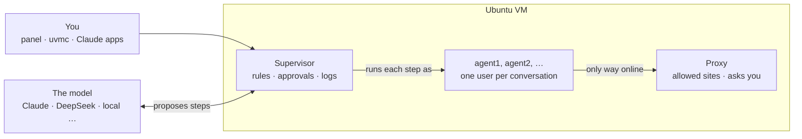

# UVMC

**Give an AI agent a computer of its own, and keep the keys.**

UVMC runs a small Ubuntu virtual machine on your PC where an AI agent works for you: it runs commands, writes code, edits files and builds small tools. It acts only through a supervisor you control. Every step shows up live in a control panel in your browser, anything risky waits for your approval, and Linux itself keeps the agent inside its walls.


## Features

- **A real machine for the agent.** It works in its own Ubuntu VM ([Multipass](https://canonical.com/multipass)), not on your PC. It can install Python and npm packages, run servers and scripts, and keep files between tasks.
- **Every step in front of you.** The control panel shows the agent's messages, each command with its output, the programs it started and the sites it contacted, as it happens. **Stop** ends a task at any moment, and **Undo this task** puts the files back.
- **You approve what matters.** System packages, sites that aren't on your list, changes to folders from your PC, and new tools all wait for a click. The agent can't approve its own requests.
- **Several conversations, several agents at once.** Open conversations side by side in tabs, each with its own agent and model, working at the same time. Each one runs as its own Linux user, in its own copy of the work folder and behind its own proxy, so they can't step on each other.
- **Conversations that share their work.** **Bring into the main folder** merges a conversation's work with what the others brought in. When two conversations changed the same lines, an agent resolves the conflict the way a developer would: it reads both versions, the other conversation's whole log and its folder, then proposes a result for you to accept.
- **A coordinator and its workers.** Pick a worker model, and the agent you talk to becomes a coordinator: it plans with you and hands self-contained jobs to an independent worker, which does them inside the same walls and reports back. The coordinator itself can't change the machine.
- **Your choice of model.** Claude through the API or on your Claude plan (through Claude Code, with all its own tools switched off), or any OpenAI-compatible model: DeepSeek, Gemini, OpenRouter, or a model running on your own graphics card (`local-model` sets up llama.cpp and a model sized to your card; no account needed). You pick per conversation, even mid-way; a strong coordinator with a cheaper worker keeps costs down.
- **Tools the agent builds.** Ask for something that keeps running, like *"every morning, check this page and note what changed"*. The agent writes and tests a small program and proposes it. Once you approve it, the program runs on a schedule as its own user, reaching only the sites it declared.
- **Folders from your PC, safely.** Share folders when you open the panel. The agent reads them, but can't change them: every change is a card with a diff, and the original is backed up first.
- **Use it from anywhere on your PC.** The `uvmc` command, an HTTP API, and an extension that lets Claude Code and Claude Desktop hand tasks to the agent.


## Several agents at once

**Conversations run side by side.** **New conversation** opens another tab; up to 3 work at the same time by default, each with its own model, timeline, approvals and **Stop**. Tasks from scripts and from your PC's Claude apps get tabs of their own. Every conversation is fenced off from the others by Linux: its own user (agent1, agent2, …), its own copy of the work folder, its own proxy and firewall rule, and its own share of memory and processes. An approval appears only in the conversation that asked, **Undo** touches only its own copy, and **Stop** ends only its own programs.

**They share work through the main folder.** The main work folder is the shared version; each conversation reads it but changes only its copy. **Bring into the main folder** shows what would change first, then merges both ways: the conversation's changes go in (with an undo point), and what other conversations brought in comes back to its copy. Edits to different parts of a text file merge line by line. When two conversations changed the same lines, an agent resolves it like a developer resolves a git conflict. It works out what each side was doing, from both versions, the other conversation's whole log (as a readable transcript) and its folder, then keeps both sides' work. Its result waits for you: per file, accept it, keep either version, or decide later. A beta option hands the file to the other conversation's agent instead, when that side knows the change best.

**A coordinator can direct workers.** Choose a **Worker** next to the model, and the agent you talk to becomes a coordinator (the orchestrator–worker pattern). It discusses the task with you, plans, and hands each job to the worker as self-contained instructions. The worker starts with no memory of your conversation, does the job with the normal tools inside the same walls, and reports back. The coordinator can read files to check the results, but can't change anything itself. In the panel, each job's instructions and the worker's steps appear nested under the coordinator's step, and approvals still come to you.

## Tools the agent builds

Some jobs should keep running after the conversation ends: a morning summary, a page to watch, a file to tidy every night. Ask for one, and the agent writes a small program in its work folder, tests it, and proposes it. The card shows everything the tool would be: what it does, when it runs, the sites it reaches, the settings and secrets it will ask you for, and its full code. Nothing is installed until you approve.

Approved tools live in the **Tools** tab, where you fill in their settings, switch them on, run them now, and read every run's output. Each tool runs as its own Linux user, from a frozen copy the agent can't change, and reaches only the sites it declared. A secret you type in its settings goes to the tool only when it runs; the agent never sees it. A change to a tool is a new proposal, shown as a diff.


## How it works



The model never touches the machine. It proposes a step, the supervisor checks the step against your rules (allow, ask you, or refuse), runs it as the conversation's own user, and logs it. The walls are enforced by Linux, not by guessing what a command does: no root, a firewall that leaves only the proxy, memory and process limits, and a fixed-size disk. Machine controls (stop, snapshot, factory reset) stay on your PC, out of the agent's reach.

## Requirements

- **Windows** 10 or 11 Pro, Enterprise or Education (needs Hyper-V), **macOS**, or **Linux**.
- About 5 GB of free disk at first (it can grow to about 16 GB). The VM takes 2 GB of memory, or 3 GB if your computer has 12 GB or more.
- A model to think with: an Anthropic API key, a Claude Pro or Max plan, or another provider's key or a local model.

## Install

Download or clone this repository, then:

| Windows | macOS / Linux |
| --- | --- |
| double-click `windows\install.cmd` | run `unix/install.sh` |

The installer asks for admin rights once, turns on Hyper-V if needed (one restart; it continues by itself), installs Multipass if it's missing, creates the VM, installs the supervisor, offers to store an API key, and takes a `clean` snapshot to reset to. On Windows it also adds a **UVMC Panel** shortcut. The first install takes 5-10 minutes, mostly downloads.

## Run

1. **Open the panel:** the **UVMC Panel** shortcut, `windows\panel.cmd`, or `unix/panel.sh`. It asks which folders from your PC the agent may see this time, then opens the panel in your browser.
2. **Give it a brain:** in **Settings**, paste an API key, or click **Sign in with your Claude plan**.
3. **Type a task** and press Enter. Watch the steps, answer the approval cards, and bring the work into the main folder when you're happy with it.

The agent keeps working when you close the browser; the panel catches up when you come back.

| | Windows | macOS / Linux |
| --- | --- | --- |
| Open the panel | `UVMC Panel` shortcut or `windows\panel.cmd` | `unix/panel.sh` |
| Push changes to the supervisor into the VM | `windows\update.cmd` | `unix/update.sh` |
| Run a task from a terminal | `windows\uvmc.cmd ask "..."` | `unix/uvmc ask "..."` |
| Let Claude Code and Claude Desktop use UVMC | `windows\connect-claude-apps.cmd` | `unix/connect-claude-apps.sh` |
| Make sample files to try it with | `windows\make-testdata.cmd` | `unix/make-testdata.sh` |
| Stop the VM | `windows\stop.cmd` | `unix/stop.sh` |
| Factory reset | `windows\reset.cmd` | `unix/reset.sh` |
| Uninstall (asks first, offers to save the agent's work) | `windows\uninstall.cmd` | `unix/uninstall.sh` |

The [guide](docs/guide.md) lists every script and covers the panel, models, the walls, the API and configuration in detail.

## Configuration

Settings live in [supervisor/config.toml](supervisor/config.toml): models, limits, allowed sites, and allow / ask / deny rules. Most of it can also be changed in the panel's **Settings** tab. What the agent is told is in [house_rules.md](supervisor/house_rules.md), editable in the panel too. After editing files in `supervisor/`, run `update`.

## Development

The supervisor is Python (FastAPI) and the panel is a single HTML file, with no build step. The tests run offline with a stand-in model:

```
cd supervisor
pip install -r requirements.txt httpx
UVMC_NO_SUDO=1 python3 -m unittest discover tests
```

- [docs/guide.md](docs/guide.md): the full guide, including a map of the supervisor's files.
- [docs/design.md](docs/design.md): the design, the reasoning behind it, and the roadmap.

## Status

Version 0.12.4, a personal project in active development. It has been tried on a real VM on Windows: install, the panel, API and plan models, the Claude Desktop extension, several conversations with bring-in and agent-resolved conflicts, and tools the agent builds. It hasn't been tried yet on Mac and Linux hosts or with OpenAI-compatible models on live keys. Next up: a proper installer (`UVMC-Setup.exe`).

Using UVMC with your Claude plan is meant for your own use: don't run it as a service for other people on your plan.

## License

UVMC is free software under the [GNU Affero General Public License v3.0](LICENSE). You may use, study, change and share it. If you share a changed version, or let other people use one over a network, you must offer them its source under the same license.
