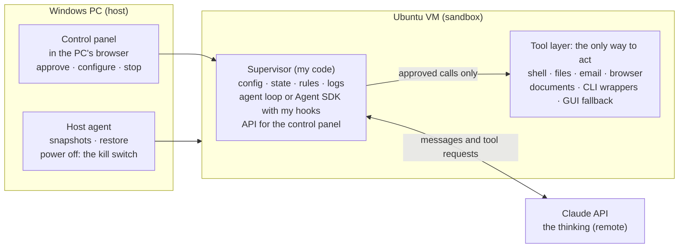
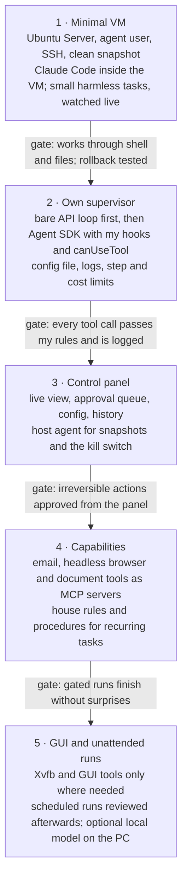

# AI-Controlled VM: Design

Nov 5, 2026 · live version: https://claude.ai/artifact/845k16efYZy28TgFB6ptSV

## Overview

The goal is a small Ubuntu VM that an AI agent can fully operate, run by my own supervisor code, with a control panel for configuration and oversight. Claude (through the API or the Agent SDK) provides the thinking; everything else is owned by me.

Guiding principles:

- **The interface is the system.** The agent never touches the machine directly. It acts only through a defined set of tools, and that layer decides what it can see and do.
- **Highest-level interface first.** Shell, files and APIs before browser automation; browser automation before pixel-level GUI control.
- **My code is the boss.** Config, state, permission rules and logs live in my supervisor. Claude and the SDK are components it calls.
- **Start tiny, grow from observation.** Begin with a shell and files, then add tools when the agent visibly needs them.
- **Outer walls stay outside.** Snapshots and the kill switch live on the host, out of the agent's reach.



Claude only proposes actions; the supervisor decides, the tool layer executes, and the host keeps the snapshots and the off-switch.

## The VM

The VM is Ubuntu Server with no desktop environment, hosted on the Windows PC. The model runs on Anthropic's servers, so the VM only executes actions and can stay very small.

**Hypervisor:** Hyper-V or VirtualBox on the Windows PC. Both support snapshots. Docker is an option for quick prototypes but gives weaker isolation than a real VM.

**Sizing by stage** (approximate):

| Stage | RAM | vCPU | Disk |
| --- | --- | --- | --- |
| Shell and files only | 512 MB–1 GB | 1 | 5 GB |
| + Claude Code / Agent SDK (Node) | 1–2 GB | 1–2 | 10 GB |
| + headless browser (Playwright) | 2 GB+ | 2 | 15 GB |
| + virtual display or XFCE desktop | 2–4 GB | 2 | 20 GB |

A local model, if added later, runs on the host GPU, not inside the VM.

**No graphics by default.** Playwright runs Chromium headless and can still take screenshots. A GUI-only app gets a virtual display through Xvfb. A full XFCE desktop with VNC is only needed for comfortable live watching.

**Setup steps:**

1. Install Ubuntu Server LTS in the VM.
2. Create a normal (non-root) user for the agent.
3. Enable SSH; install git, Python 3, curl and Node.
4. Take a clean snapshot: the factory-reset point.
5. Snapshot again before any risky task or new capability.

## The interface layer

The agent acts only through a defined set of tools: it requests an action, my code executes it, and it sees only the result. This layer is the agent's whole world, its hands and its eyes.

Tools differ in how much they let through:

| Kind | Examples | Gives | Costs |
| --- | --- | --- | --- |
| Narrow | `read_email`, `send_draft`, `create_doc` | Control, predictability, easy approval rules | Each one must be built |
| General | Shell, full mouse and keyboard | Power, flexibility, works on anything | Can route around other tools; the layer gets thin |

The working rule: narrow tools for anything sensitive (email, money, accounts), and a general shell only inside the sandboxed VM, where its worst mistake can be rolled back.

**Capability order** (agents learn computers roughly the way people did):

1. **Shell:** text in, text out. The strongest channel for language models.
2. **Files:** read and write documents, configs and code directly.
3. **APIs and scripting:** talk to programs instead of operating them (email APIs, Blender's Python API, Playwright).
4. **Browser:** structured web access through the page's DOM and accessibility tree.
5. **GUI:** screenshots plus mouse and keyboard. The last resort, for software with no other way in.

## Tools by capability

Each capability is its own tool group, exposed as an MCP server or in-process tools, so any agent (Claude Code, the Agent SDK, my own loop, a local model) can use it and each can be tested and swapped on its own.

| Capability | Implementation | Core tools | Design notes |
| --- | --- | --- | --- |
| Shell | subprocess in a working directory | `run_command(cmd, timeout)` | Timeouts; truncate output to head and tail with "N lines omitted"; denylist for destructive commands |
| Files | direct file I/O | `read_file`, `write_file`, `edit_file`, `list_dir` | Claude's text editor tool (`text_editor_20250728`) already has this shape |
| Email | IMAP/SMTP, or Gmail / Microsoft Graph API | `search`, `read`, `list_threads`, `draft`, `send(draft_id)` | Draft and send are separate calls: a natural approval gate; return plain text, strip HTML |
| Browser | Playwright (headless Chromium) | `goto`, `snapshot`, `click`, `fill`, `get_text`, `screenshot` | `snapshot` returns the accessibility tree or interactive elements with ids; persistent profile keeps logins |
| Documents | pandoc, python-docx, openpyxl, PDF text extraction | `create_doc(markdown, format)`, `read_doc(path)` | Agent writes Markdown or JSON; code converts. Never drive an office suite by GUI |
| CLI software | thin wrappers per tool | e.g. `git_status`, `blender_run_script` | Prefer the app's own CLI or scripting API over its GUI |
| GUI (fallback) | Xvfb + xdotool + scrot, or Claude's computer use tool | `screenshot`, `click(x,y)`, `type`, `key`, `wait_for_change` | Read the accessibility tree (AT-SPI) to target "Button: Save" instead of coordinates; keep about 1280×800 |

**Cross-cutting rules for every tool:**

- Short, structured results. Errors say what went wrong and what is possible ("element not found; visible buttons: Save, Cancel").
- Every tool is tagged **read-only**, **reversible** or **irreversible**. The tag drives approval rules in the supervisor.
- Every call and result is logged.

**Anthropic-provided tool types** are worth reusing because Claude already knows their shape well: the bash tool (`bash_20250124`), the text editor tool (`text_editor_20250728` for Claude 4 and later models), and the computer use tool (`computer_20251124`, still beta with header `computer-use-2025-11-24`). They are client tools: I write the executor that actually runs them.

## Controlling how actions are done

Most tasks can be done several ways (reading email could mean webmail, installing a mail client, or writing a script). Control comes in five layers, strongest first:

1. **What exists.** The agent can only use tools I provide. If `read_email` exists and no browser does, that is the only path.
2. **What's allowed.** Fence off paths that technically exist: the browser refuses mail domains, package installs need approval.
3. **What it's told.** A system prompt or "house rules" file: "Use the email tools for email; never use webmail. Ask before installing software." Rules with reasons are followed best.
4. **How tools describe themselves.** Clear names and descriptions ("the preferred way to access the inbox") steer choices.
5. **Procedures for recurring tasks.** Write the recipe once (skills): "To triage email: search unread, summarize, draft replies, wait for approval."

**Self-built tools are their own category.** The agent may write scripts for one-off tasks, but must ask before creating a new permanent tool. Approved tools get added to the toolset deliberately.

In practice: one obvious good path per task, preferences written down, unwanted paths fenced off, and improvisation only where nothing is decided yet.

## The supervisor

The supervisor is a long-running program in the VM that I own. Claude and the SDK are components it uses; it holds everything that matters.

| Owns | Contents |
| --- | --- |
| Config | Model, enabled tools, permission rules, step and budget limits, system prompt. One versioned file (YAML or TOML) |
| State | Current task, history, status: running, paused, waiting for approval, stopped |
| Rules | Every tool call passes through supervisor code: allow, ask, or deny |
| Logs | Every message, tool call and result, plus token and cost totals |
| API key | Read from an environment variable, never stored in code or config |

**The agent loop** (the core of option A below):

```
messages = [task]
loop (until done or step limit):
    reply = claude(messages, tools)
    if reply has no tool calls: done
    for each tool call:
        decision = rules.check(call)      # allow / ask / deny
        result = executor.run(call) or denial message
        log(call, result)
        append result to messages
```

Long tasks need context management: trim or summarize old tool results as the conversation grows.

**Two ways to plug in the brain:**

| | A. Claude API directly | B. Claude Agent SDK |
| --- | --- | --- |
| Loop | Written by me | Provided |
| Context management | Written by me | Provided |
| Tools | Anthropic tool types + my own definitions | Built-in Claude Code tools + my own as in-process MCP tools |
| Control | Total: my code is the loop | Through permission modes, rules, hooks and the `canUseTool` callback |
| Packages | `anthropic` (Python) | `claude-agent-sdk` (Python) or `@anthropic-ai/claude-agent-sdk` (TS); runs the Claude Code binary |
| Best for | Learning, minimal setups, full ownership | Getting capable fast without losing authority |

**How the SDK keeps my code in charge.** Every tool request is evaluated in a fixed order: PreToolUse hook, deny rules, allow rules, ask rules, permission mode, then the `canUseTool` callback, then the PostToolUse hook after execution. So:

- `disallowed_tools` removes tools entirely; `allowed_tools` pre-approves them, but pre-approved calls still pass through the PreToolUse hook.
- A **PreToolUse hook** can block or modify any call (e.g. deny `rm -rf` or `sudo`), even in bypass mode.
- **`canUseTool`** fires whenever a permission prompt would appear. This is where the supervisor routes "ask" decisions to the control panel's approval queue.
- A **PostToolUse hook** writes the audit log.

Recommended path: write the bare API loop once to understand it, then run the real system on the Agent SDK with my hooks and callback as the authority.

### Claude on a subscription plan (as built, v0.8)

A Claude Pro/Max plan can replace the API as the brain without giving up control. Claude Code, signed in with the plan through a one-year token (`claude setup-token`), runs headless (`claude -p`, stream-json in and out) as a separate user, `uvmc-brain`:

- **No hands of its own.** `--tools ""` removes every built-in tool. Its only tools come from a small MCP server that forwards each call to the supervisor over a unix socket. The supervisor treats those calls like any model's: rules, approval cards, logs, and execution as `agent`. So the supervisor is the layer between the subscription agent and the machine, as with the API loop.
- **The login can't leave.** The token lives in the supervisor's key store and is passed only in the brain process's environment. The agent can't read another user's files or processes. The brain user's firewall allows only its own proxy, which allows only Anthropic's sites. It starts in an empty root-owned folder, so nothing can plant settings, hooks or instructions for it.
- **One chat.** The supervisor translates Claude Code's stream into the same timeline events, so the panel doesn't know the difference. Switching between plan and API models carries the conversation over as text.
- **Not used:** hooks and managed settings. With no built-in tools there's nothing for a PreToolUse hook to guard. A machine-wide managed policy would also lock down the agent's own Claude Code, which still needs its tools.

## Control panel

The control panel is a small web app served by the supervisor and opened from the Windows PC's browser. It is a view onto the supervisor, not a separate system: every button calls the supervisor's API.

| Screen | What it does |
| --- | --- |
| Live view | Streams the agent's messages, tool calls and results as they happen |
| Controls | Start a task, pause, resume, stop; a hard kill button |
| Approval queue | Pending "ask" actions with full details (e.g. the exact email to be sent): approve or deny |
| Config | Toggle tools, edit permission rules and house rules, change model, set step and cost budgets |
| History | Past runs with full logs, token usage and cost |
| VM | Snapshot, restore, power state (calls the host-side agent, see Safety) |

**Stack:**

- **Backend:** Python with FastAPI, inside the supervisor process.
- **Live updates:** WebSockets for the live view and the approval queue.
- **Frontend:** a simple single-page app (plain HTML/JS or a light framework).
- **Storage:** SQLite for runs and logs; the config file stays the source of truth for settings.
- **Access:** bound to the VM's host-only network, reachable from the Windows PC only. Add a password even on a private network.

## Safety

The VM is the outer wall; everything inside it can be rolled back, and the controls that matter most sit outside it.

**Host-side controls (outside the agent's reach).** A small host agent on the Windows PC handles snapshots, restore and power off. The control panel's VM screen asks it to act, but the agent inside the VM has no path to it. An off-switch the agent can reach is not an off-switch.

**Approval levels by tool tag:**

| Tag | Examples | Default rule |
| --- | --- | --- |
| Read-only | `read_file`, `search` email, `snapshot` page | Allow |
| Reversible | `write_file`, `draft` email, shell in work directory | Allow, logged |
| Irreversible | `send` email, delete, purchase, package install, new permanent tool | Ask: goes to approval queue |

**Other guards:**

- **Network egress:** restrict outbound traffic to what the tools need (Anthropic API, mail server, chosen sites).
- **Credentials:** throwaway or dedicated accounts only; no main passwords or payment details in the VM. API key in an environment variable.
- **Host isolation:** no shared folders with the host filesystem.
- **Limits:** maximum steps per task and a cost budget per run, enforced by the supervisor.
- **Snapshots:** before every risky task and before adding a new capability.

**Trust stages:**

1. **Watched:** I see every step live and can stop it.
2. **Gated:** runs freely; irreversible actions wait for approval.
3. **Unattended:** scheduled or overnight runs, reviewed afterwards from History.

Move to the next stage only after the current one has run without surprises.

## Roadmap

The build runs in five phases, each useful on its own; the next phase starts only when the current one's gate is met.



Phase 1 needs no code of my own: Claude Code inside the VM is already an active agent, which makes it the fastest way to learn how the agent behaves before designing tools. (As built, this direct way in was retired in v0.8: every model, Claude Code on a plan included, now acts only through the supervisor.)

## Planned work (agreed 2026-11-08)

In order, after the first real test of v0.8:

1. **Fixes from the first real test** (done 2026-11-08: install, sharing and sign-in fixes) of the plan mode (Stop, tool permissions, message format).
2. **Update Claude Code** in the VM from the PC (it never updates itself). Done 2026-11-08: panel button and `update-claude`, through `uvmc-install-claude`.
3. **Plan usage in the header** instead of token counts that mislead for the plan models (done 2026-11-08, from Claude Code's rate-limit events). Also (done 2026-11-08) a **"Sign in with your Claude plan" button** in Settings: the supervisor runs Claude Code's own `setup-token` in the background, the panel shows the link and a box for the code, and the token is saved without being shown (the `sign-in-claude` script stays as a fallback). Can be done earlier whenever needed.
3b. (Done 2026-11-08, as Settings › What the agent is told: house rules, live briefing and your notes, kept apart, each visible and editable.) **A live briefing for the agent** at the start of each conversation, on top of the fixed house rules: UVMC's version, which model it is (and whether it's coordinating a worker), the folders shared right now, the allowed sites, its limits, what's in the work folder, today's date, and what the panel can do for the user (approvals, undo, stop). Generated by the supervisor, so it's always current, and short.
4. **API extras:** a `uvmc` command on the PC, a "run and wait" endpoint, API docs (`/docs`). Done 2026-11-08.
5. (Done 2026-11-08: a stdio relay `uvmc mcp` for both apps, set up by connect-claude-apps, plus a switch in Settings.) **The PC's Claude apps using the VM** (MCP), optional and switched on by the user: an HTTP endpoint in the supervisor for Claude Code, a small relay for Claude Desktop, set up by the installer.
6. **Codex on a ChatGPT plan**, if its shell can be fully turned off so it acts only through the supervisor. Parked 2026-11-08 (no ChatGPT plan to test with). Checked with Codex CLI 0.167.0 by capturing the request it sends to a fake model server:
   - `--disable shell_tool --disable unified_exec` removes its shell (`exec_command`); browser, computer use, image tools, apps and plugins switch off the same way (`--disable <feature>`).
   - What stays: `apply_patch` (file edits), the sub-agent tools (`spawn_agent` and friends; sub-agents get the same tools), the MCP resource tools, the clock and asking the user. Codex 0.167 wraps tools in a JavaScript `exec` tool ("code mode"); that runs in an isolate with no file system or network.
   - `apply_patch` can't be removed by a setting (`include_apply_patch_tool=false` is ignored), so the wall has to be the OS, as for Claude Code: Codex runs as its own user with `--sandbox read-only`, starts in an empty root-owned folder and can reach only OpenAI's sites. Then `apply_patch` can't write anything, and everything real goes through UVMC's MCP tools.
   - Sign-in: `codex login --device-auth` (a link and a short code), done from the panel like the Claude one.
7. **Tools the agent builds** (any kind of task; Gmail auto-reply was only the example). Done 2026-11-08 (v0.11, `made_tools.py`, Tools tab), as planned below with these limits for now: tools reach the internet only over HTTP(S) through their proxy (no IMAP/SMTP or other protocols yet); they use the programs installed on the machine and can't install their own packages; "draft mode" isn't enforced (a tool acts with the settings and secrets you give it, so the approval card says what it asks for); approved tools aren't offered as tools to the models or the PC's Claude apps yet. Each tool already runs as its own user with its own proxy and firewall rule, the isolation 7c wants for conversations.
   - The agent writes and tests the code, plus a description file: purpose, how it runs (schedule, always on, on call), the settings and secrets it needs, the sites it must reach.
   - It proposes the tool: an approval card with the code, schedule, sites and secrets. Once approved, the supervisor freezes a copy the agent can't edit; any change is a new proposal with a diff.
   - A Tools tab: on/off, last run, log, run now, and a settings form drawn from the description file. Steps the user must take (like a sign-in) are part of the setup.
   - Safety: each tool runs as its own user from the frozen copy, reaches only its declared sites, gets its secrets from the supervisor only when it runs, and acts as the user ("send", "delete") only in draft mode until the user allows more. Model calls go through the supervisor.
   - Approved tools can also become tools for the models, and for the PC's Claude apps (5).
   - Reports (asked by the user 2026-11-09: a test tool's output could only be read in the side panel). Done 2026-11-09 (v0.13, `reports.py`): a Reports tab beside the conversations (the user didn't want results in the conversation): a card per tool with its status and first numbers, its full report and earlier runs one click away, a count of new ones, and browser notifications per tool (never, when it asks with `"notify"`, fails or reports a problem, or after every run). The tool writes a JSON report from a fixed set of blocks, which the panel draws itself; chosen over showing a tool's own HTML page, which would run its code (or scraped content) with the panel's access, and over a sandboxed frame or Adaptive Cards (no charts, its own look, a large renderer to keep up to date). Buttons and forms are left out on purpose: a report shows, it doesn't act. A block that's missing gets added to the format once, for every tool. Changing a tool: **Work on this tool** opens a new conversation with the approved code copied into its folder (not the conversation that built it: it may be closed, or about something else by then), and agents can fetch a tool's code with `get_tool_code`. The installed copy stays frozen; a change is still a proposal.
7b. **Several conversations at the same time:** a list of conversations in the panel, each with its own model, timeline and approvals, running side by side. Needs thought: they share the agent user, its work folder and its resource box (separate work folders per conversation, or a shared one with care), Undo per conversation, one Claude Code process per active plan conversation (memory), and approvals that say which conversation asks.
   Done 2026-11-08 (v0.10), with these choices:
   - Tabs above the timeline; each conversation has its own model, worker, log, approvals and Stop. At most `[conversations] max_open` (8) open (the oldest idle one closes) and `max_running` (3) working at once.
   - (Replaced by 7c.) One shared work folder, as before: the agent is still one user, and separate folders would hide one conversation's results from the next. The briefing tells the agent other conversations may work beside it. Undo puts back the whole folder, so it waits until no conversation works.
   - Each conversation runs its commands in its own systemd slice inside the agent's (`uvmc-agent-<id>.slice`): the agent's limits cover all of them together, Stop kills only that conversation's programs, and the activity watcher tells which conversation started a program from its cgroup.
   - (Replaced by 7c.) The proxy can't tell which conversation opens a connection. With one working, it's that one; with several, a new site is asked in each working conversation and one answer counts for all. "Allow for this task" lasts until no conversation works. Site rows go to the one working conversation, else only to the Activity tab.
   - Each "my plan" conversation runs its own Claude Code. Its MCP server gets a random key for its conversation, so tool calls land in the right one (a key, not the id, so one conversation's brain can't act in another's).
   - Scripts (`/api/run` with `new`) and the PC's Claude apps (`run_task`) get conversations of their own, marked in their tab, so they work while you use the panel.
7c. **Conversations isolated from each other** (flagged by the user 2026-11-08: in v0.10 they shared the machine, so Undo had to wait for every conversation and a new site was asked in all of them). Done 2026-11-08 (v0.12, `workcopies.py`):
   - A pool of users agent1..agent8 made by setup, one per open conversation, each with its own copy of the work folder (`/home/agent/conv/<id>`), its own proxy port (3300+n) and firewall chain, and its own box inside the agent's. Every program, connection and approval belongs to one conversation; Undo works on its own copy.
   - The work folder (`/home/agent/work`) is the main version, called the main folder in the panel (not "shared", so it isn't confused with the folders shared from the PC). Conversations read it but don't change it.
   - **Bring into the main folder**, per conversation: a three-way comparison per file (the base, its copy, the main folder now). One-sided changes go in; changes to different lines merge with `git merge-file`; an undo point of the main folder is made first.
   - Every real conflict is resolved by an agent like Claude Code resolves a git conflict: it gets both versions and the common one in `.uvmc-merge/`, the other conversation's whole log as a transcript (`transcript.py`), and read access to the main folder and the other copies. UVMC itself suggests nothing. Its result is a proposal, kept apart (UVMC stashes every version) until you review it: accept, keep this conversation's, keep the main folder's, decide later, or (beta) let the conversation whose version is in the main folder resolve it instead. A file handed to another conversation stays out of this conversation's bring-in until you answer that proposal (v0.12.4); deciding later, or closing the other, opens the conflict here again.
   - Copies survive a restart; their conversations come back.
   Wanted later (the user, 2026-11-08: "a cool feature we might want later anyway"): a conversation asking another conversation's agent a question. Built once and taken out for now: the context above is usually enough, it costs a task in the other conversation, and handing a conflict to the other conversation covers the "one model is much stronger" case. When it comes back, it goes through the supervisor (the user, 2026-11-08): one agent sends a message to the supervisor, which delivers it to the other conversation and the answer back, logged in both and under the same rules; the asked conversation only looks (approvals refused), and it waits while the other is busy. For conflicts it isn't needed: the resolving agent gets the other conversation's whole log as a readable transcript in .uvmc-merge/ (transcript.py), which holds everything that agent knew.
7d. **A model on the PC's graphics card** (asked by the user 2026-11-08: Mac, NVIDIA, AMD, and older cards like their RX 5700 XT). Done 2026-11-08 (v0.12.5, `local-model`, `pc.py`):
   - llama.cpp's own server, not Ollama: the user doesn't want Ollama's subscription side. Vulkan on Windows and Linux covers every vendor through the normal driver, old AMD cards included (ROCm doesn't support RDNA1); Metal on a Mac.
   - One model at a time, Qwen3 (4B to 32B) sized to the card's memory, from the Qwen team's Hugging Face page; llama.cpp from its GitHub releases; both checked against published checksums.
   - Measured on the RX 5700 XT (8 GB): flash attention falls back to the processor (off for AMD/Intel), and the default work buffer pushed the model into shared memory (`-ub 256`: 18 s instead of 32 s for a 7,000-token prompt). Qwen3 8B: 30-55 tokens/s writing, ~400 reading, tool calls correct.
   - Walls: the server listens on the PC and the VM's network only, needs a key kept in the VM, and the proxy refuses the PC's address. The profile's `{pc}` is filled in from the VM's gateway each time (Windows changes that network at each restart).
   - Not yet: trimming a conversation that outgrows the model's context (it's refused with a clear message), choosing a model in the panel (the PC script does it), the Mac/Linux script tested on real hardware.
7e. **Multipass 1.17** (next, before the installer; the user, 2026-11-08: libraries must be up to date before we build on them). UVMC is pinned to 1.16.4 (`install.ps1`, `check-download.cmd`); 1.17.0 came out 2026-10-19 and isn't in winget yet. What changes:
   - A new Windows driver on the Host Compute System APIs replaces Hyper-V (and VirtualBox), works on every Windows edition including Home, and migrates existing Hyper-V machines. A preview Apple Virtualization driver on macOS.
   - `multipass exec` and `shell` pass the inside command's exit code through (255 is Multipass's own failure); a `multipass wait-ready` command.
   - Not in its notes: a fix for input piped into `multipass exec` hanging on Windows (the reason `set-key` was removed in 0.12.6); test it.
   Steps:
   1. On the user's PC: `stop.cmd` (saves logs), bring work into the main folder, then upgrade and let it migrate `uvmc`.
   2. Check everything that touches Multipass or the VM's network: install (Hyper-V steps, storage folder, `check-download`), `update`, `panel` and shared folders, `shell`, `uvmc.cmd`, `connect-claude-apps`, `local-model` (the VM's network adapter and gateway, `{pc}`, the firewall rule's interface), `reset` and the `clean` snapshot, `uninstall`.
   3. Retest piping into `multipass exec`; if it works again, `set-key` could come back, but the panel stays the way in.
   4. Use `wait-ready` and the exit codes in the scripts where they help.
   5. Move the pin to 1.17.x (direct download hash from the GitHub release; winget's once it lists it), drop the Hyper-V-only parts if the new driver doesn't need them, and say in the README that Windows Home works.
   6. From then on, check Multipass, llama.cpp and the Python packages for new releases before each piece of work.
7f. **Ubuntu 26.04 LTS in the VM** (found 2026-11-08 in the same check: the installers launch `24.04`, and 26.04 LTS has been out since April 2026; Multipass offers it). After 7e. New installs launch `26.04` and `cloud-init.yaml` is checked against it (packages, Python version for the venv, nftables, systemd slices, auditd, Claude Code's installer); existing machines either stay on 24.04 (supported until 2029) or move with `do-release-upgrade`, tested on a copy first. Checked the same day and up to date: anthropic 2.6.0, fastapi 0.162.2, uvicorn 0.54.0, httpx 0.28.1, Claude Code 2.1.319, llama.cpp (always fetched newest).
8. **A proper installer** (last): a setup wizard instead of the PowerShell script. On Windows, `UVMC-Setup.exe` built with Inno Setup: normal Next/Back pages and progress, listed under Apps for uninstall, Multipass bundled inside (nothing downloaded from GitHub during install), the Hyper-V restart handled, pages for the storage folder (a folder picker), memory, API key and Claude plan sign-in, and "Open UVMC Panel" at the end. Built automatically on GitHub for each release. Needs code signing to avoid Windows' SmartScreen warning (a certificate, or Microsoft's signing service). Later a `.pkg` for Mac and a script or `.deb` for Linux. Could grow into the parked helper app on the PC (tray icon: start, stop, open panel).

Parked: GPU jobs on the PC, a helper app on the PC (machine buttons in the panel, changing folders mid-session), autocomplete.

## Open questions

- [ ] What will it actually do day to day: a focused assistant (inbox, paperwork) or a general machine?
- [x] Own agent brain eventually (own loop, local model on the PC's GPU), or Claude only? Both: the supervisor's own loop drives any model, and since v0.12.5 one can run on the PC's graphics card (7d).
- [ ] Hyper-V or VirtualBox on the Windows PC?
- [ ] Which email provider, and which API (IMAP/SMTP, Gmail, Microsoft Graph)?
- [ ] Monthly API budget, and the per-run cost limit?

## Sources

- [Claude Agent SDK: permissions](https://docs.claude.com/en/api/agent-sdk/permissions): evaluation order, `canUseTool`, permission modes
- [Claude Agent SDK for Python](https://github.com/anthropics/claude-agent-sdk-python): custom in-process tools, hooks
- [Claude tool reference](https://platform.claude.com/docs/en/agents-and-tools/tool-use/tool-reference): current bash, text editor and computer use tool versions
- [Steel: Claude computer use cookbook](https://docs.steel.dev/cookbook/claude-computer-use): computer use loop and screen-size matching
- [Pinggy: cloud computers for AI agents (2026)](https://pinggy.io/blog/best_cloud_computers_for_ai_agents/): managed desktop sandboxes (E2B Desktop, Daytona, Orgo) if self-hosting is dropped
