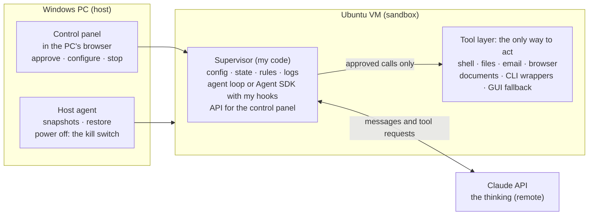
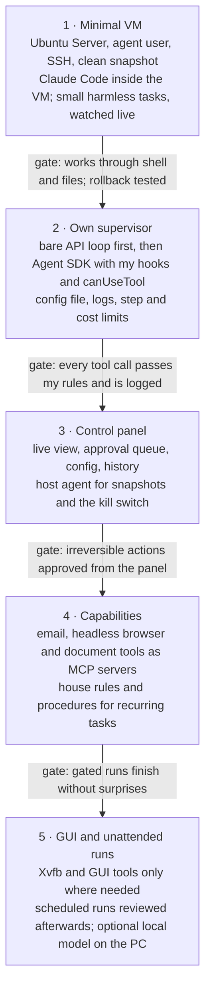

# AI-Controlled VM: Design

Nov 5, 2026 · live version: https://claude.ai/artifact/845k16efYZy28TgFB6ptSV

## Overview

The goal is a small Ubuntu VM that an AI agent can fully operate, run by my own supervisor code, with a control panel for configuration and oversight. Claude (through the API or the Agent SDK) provides the thinking; everything else is owned by me.

Guiding principles:

- **The interface is the system.** The agent never touches the machine directly. It acts only through a defined set of tools, and that layer decides what it can see and do.
- **Highest-level interface first.** Shell, files and APIs before browser automation; browser automation before pixel-level GUI control.
- **My code is the boss.** Config, state, permission rules and logs live in my supervisor. Claude and the SDK are components it calls.
- **Start tiny, grow from observation.** Begin with a shell and files, then add tools when the agent visibly needs them.
- **Outer walls stay outside.** Snapshots and the kill switch live on the host, out of the agent's reach.



Claude only proposes actions; the supervisor decides, the tool layer executes, and the host keeps the snapshots and the off-switch.

## The VM

The VM is Ubuntu Server with no desktop environment, hosted on the Windows PC. The model runs on Anthropic's servers, so the VM only executes actions and can stay very small.

**Hypervisor:** Hyper-V or VirtualBox on the Windows PC. Both support snapshots. Docker is an option for quick prototypes but gives weaker isolation than a real VM.

**Sizing by stage** (approximate):

| Stage | RAM | vCPU | Disk |
| --- | --- | --- | --- |
| Shell and files only | 512 MB–1 GB | 1 | 5 GB |
| + Claude Code / Agent SDK (Node) | 1–2 GB | 1–2 | 10 GB |
| + headless browser (Playwright) | 2 GB+ | 2 | 15 GB |
| + virtual display or XFCE desktop | 2–4 GB | 2 | 20 GB |

A local model, if added later, runs on the host GPU, not inside the VM.

**No graphics by default.** Playwright runs Chromium headless and can still take screenshots. A GUI-only app gets a virtual display through Xvfb. A full XFCE desktop with VNC is only needed for comfortable live watching.

**Setup steps:**

1. Install Ubuntu Server LTS in the VM.
2. Create a normal (non-root) user for the agent.
3. Enable SSH; install git, Python 3, curl and Node.
4. Take a clean snapshot: the factory-reset point.
5. Snapshot again before any risky task or new capability.

## The interface layer

The agent acts only through a defined set of tools: it requests an action, my code executes it, and it sees only the result. This layer is the agent's whole world, its hands and its eyes.

Tools differ in how much they let through:

| Kind | Examples | Gives | Costs |
| --- | --- | --- | --- |
| Narrow | `read_email`, `send_draft`, `create_doc` | Control, predictability, easy approval rules | Each one must be built |
| General | Shell, full mouse and keyboard | Power, flexibility, works on anything | Can route around other tools; the layer gets thin |

The working rule: narrow tools for anything sensitive (email, money, accounts), and a general shell only inside the sandboxed VM, where its worst mistake can be rolled back.

**Capability order** (agents learn computers roughly the way people did):

1. **Shell:** text in, text out. The strongest channel for language models.
2. **Files:** read and write documents, configs and code directly.
3. **APIs and scripting:** talk to programs instead of operating them (email APIs, Blender's Python API, Playwright).
4. **Browser:** structured web access through the page's DOM and accessibility tree.
5. **GUI:** screenshots plus mouse and keyboard. The last resort, for software with no other way in.

## Tools by capability

Each capability is its own tool group, exposed as an MCP server or in-process tools, so any agent (Claude Code, the Agent SDK, my own loop, a local model) can use it and each can be tested and swapped on its own.

| Capability | Implementation | Core tools | Design notes |
| --- | --- | --- | --- |
| Shell | subprocess in a working directory | `run_command(cmd, timeout)` | Timeouts; truncate output to head and tail with "N lines omitted"; denylist for destructive commands |
| Files | direct file I/O | `read_file`, `write_file`, `edit_file`, `list_dir` | Claude's text editor tool (`text_editor_20250728`) already has this shape |
| Email | IMAP/SMTP, or Gmail / Microsoft Graph API | `search`, `read`, `list_threads`, `draft`, `send(draft_id)` | Draft and send are separate calls: a natural approval gate; return plain text, strip HTML |
| Browser | Playwright (headless Chromium) | `goto`, `snapshot`, `click`, `fill`, `get_text`, `screenshot` | `snapshot` returns the accessibility tree or interactive elements with ids; persistent profile keeps logins |
| Documents | pandoc, python-docx, openpyxl, PDF text extraction | `create_doc(markdown, format)`, `read_doc(path)` | Agent writes Markdown or JSON; code converts. Never drive an office suite by GUI |
| CLI software | thin wrappers per tool | e.g. `git_status`, `blender_run_script` | Prefer the app's own CLI or scripting API over its GUI |
| GUI (fallback) | Xvfb + xdotool + scrot, or Claude's computer use tool | `screenshot`, `click(x,y)`, `type`, `key`, `wait_for_change` | Read the accessibility tree (AT-SPI) to target "Button: Save" instead of coordinates; keep about 1280×800 |

**Cross-cutting rules for every tool:**

- Short, structured results. Errors say what went wrong and what is possible ("element not found; visible buttons: Save, Cancel").
- Every tool is tagged **read-only**, **reversible** or **irreversible**. The tag drives approval rules in the supervisor.
- Every call and result is logged.

**Anthropic-provided tool types** are worth reusing because Claude already knows their shape well: the bash tool (`bash_20250124`), the text editor tool (`text_editor_20250728` for Claude 4 and later models), and the computer use tool (`computer_20251124`, still beta with header `computer-use-2025-11-24`). They are client tools: I write the executor that actually runs them.

## Controlling how actions are done

Most tasks can be done several ways (reading email could mean webmail, installing a mail client, or writing a script). Control comes in five layers, strongest first:

1. **What exists.** The agent can only use tools I provide. If `read_email` exists and no browser does, that is the only path.
2. **What's allowed.** Fence off paths that technically exist: the browser refuses mail domains, package installs need approval.
3. **What it's told.** A system prompt or "house rules" file: "Use the email tools for email; never use webmail. Ask before installing software." Rules with reasons are followed best.
4. **How tools describe themselves.** Clear names and descriptions ("the preferred way to access the inbox") steer choices.
5. **Procedures for recurring tasks.** Write the recipe once (skills): "To triage email: search unread, summarize, draft replies, wait for approval."

**Self-built tools are their own category.** The agent may write scripts for one-off tasks, but must ask before creating a new permanent tool. Approved tools get added to the toolset deliberately.

In practice: one obvious good path per task, preferences written down, unwanted paths fenced off, and improvisation only where nothing is decided yet.

## The supervisor

The supervisor is a long-running program in the VM that I own. Claude and the SDK are components it uses; it holds everything that matters.

| Owns | Contents |
| --- | --- |
| Config | Model, enabled tools, permission rules, step and budget limits, system prompt. One versioned file (YAML or TOML) |
| State | Current task, history, status: running, paused, waiting for approval, stopped |
| Rules | Every tool call passes through supervisor code: allow, ask, or deny |
| Logs | Every message, tool call and result, plus token and cost totals |
| API key | Read from an environment variable, never stored in code or config |

**The agent loop** (the core of option A below):

```
messages = [task]
loop (until done or step limit):
    reply = claude(messages, tools)
    if reply has no tool calls: done
    for each tool call:
        decision = rules.check(call)      # allow / ask / deny
        result = executor.run(call) or denial message
        log(call, result)
        append result to messages
```

Long tasks need context management: trim or summarize old tool results as the conversation grows.

**Two ways to plug in the brain:**

| | A. Claude API directly | B. Claude Agent SDK |
| --- | --- | --- |
| Loop | Written by me | Provided |
| Context management | Written by me | Provided |
| Tools | Anthropic tool types + my own definitions | Built-in Claude Code tools + my own as in-process MCP tools |
| Control | Total: my code is the loop | Through permission modes, rules, hooks and the `canUseTool` callback |
| Packages | `anthropic` (Python) | `claude-agent-sdk` (Python) or `@anthropic-ai/claude-agent-sdk` (TS); runs the Claude Code binary |
| Best for | Learning, minimal setups, full ownership | Getting capable fast without losing authority |

**How the SDK keeps my code in charge.** Every tool request is evaluated in a fixed order: PreToolUse hook, deny rules, allow rules, ask rules, permission mode, then the `canUseTool` callback, then the PostToolUse hook after execution. So:

- `disallowed_tools` removes tools entirely; `allowed_tools` pre-approves them, but pre-approved calls still pass through the PreToolUse hook.
- A **PreToolUse hook** can block or modify any call (e.g. deny `rm -rf` or `sudo`), even in bypass mode.
- **`canUseTool`** fires whenever a permission prompt would appear. This is where the supervisor routes "ask" decisions to the control panel's approval queue.
- A **PostToolUse hook** writes the audit log.

Recommended path: write the bare API loop once to understand it, then run the real system on the Agent SDK with my hooks and callback as the authority.

### Claude on a subscription plan (as built, v0.8)

A Claude Pro/Max plan can replace the API as the brain without giving up control. Claude Code, signed in with the plan through a one-year token (`claude setup-token`), runs headless (`claude -p`, stream-json in and out) as a separate user, `uvmc-brain`:

- **No hands of its own.** `--tools ""` removes every built-in tool. Its only tools come from a small MCP server that forwards each call to the supervisor over a unix socket. The supervisor treats those calls like any model's: rules, approval cards, logs, and execution as `agent`. So the supervisor is the layer between the subscription agent and the machine, as with the API loop.
- **The login can't leave.** The token lives in the supervisor's key store and is passed only in the brain process's environment. The agent can't read another user's files or processes. The brain user's firewall allows only its own proxy, which allows only Anthropic's sites. It starts in an empty root-owned folder, so nothing can plant settings, hooks or instructions for it.
- **One chat.** The supervisor translates Claude Code's stream into the same timeline events, so the panel doesn't know the difference. Switching between plan and API models carries the conversation over as text.
- **Not used:** hooks and managed settings. With no built-in tools there's nothing for a PreToolUse hook to guard. A machine-wide managed policy would also lock down the agent's own Claude Code, which still needs its tools.

## Control panel

The control panel is a small web app served by the supervisor and opened from the Windows PC's browser. It is a view onto the supervisor, not a separate system: every button calls the supervisor's API.

| Screen | What it does |
| --- | --- |
| Live view | Streams the agent's messages, tool calls and results as they happen |
| Controls | Start a task, pause, resume, stop; a hard kill button |
| Approval queue | Pending "ask" actions with full details (e.g. the exact email to be sent): approve or deny |
| Config | Toggle tools, edit permission rules and house rules, change model, set step and cost budgets |
| History | Past runs with full logs, token usage and cost |
| VM | Snapshot, restore, power state (calls the host-side agent, see Safety) |

**Stack:**

- **Backend:** Python with FastAPI, inside the supervisor process.
- **Live updates:** WebSockets for the live view and the approval queue.
- **Frontend:** a simple single-page app (plain HTML/JS or a light framework).
- **Storage:** SQLite for runs and logs; the config file stays the source of truth for settings.
- **Access:** bound to the VM's host-only network, reachable from the Windows PC only. Add a password even on a private network.

## Safety

The VM is the outer wall; everything inside it can be rolled back, and the controls that matter most sit outside it.

**Host-side controls (outside the agent's reach).** A small host agent on the Windows PC handles snapshots, restore and power off. The control panel's VM screen asks it to act, but the agent inside the VM has no path to it. An off-switch the agent can reach is not an off-switch.

**Approval levels by tool tag:**

| Tag | Examples | Default rule |
| --- | --- | --- |
| Read-only | `read_file`, `search` email, `snapshot` page | Allow |
| Reversible | `write_file`, `draft` email, shell in work directory | Allow, logged |
| Irreversible | `send` email, delete, purchase, package install, new permanent tool | Ask: goes to approval queue |

**Other guards:**

- **Network egress:** restrict outbound traffic to what the tools need (Anthropic API, mail server, chosen sites).
- **Credentials:** throwaway or dedicated accounts only; no main passwords or payment details in the VM. API key in an environment variable.
- **Host isolation:** no shared folders with the host filesystem.
- **Limits:** maximum steps per task and a cost budget per run, enforced by the supervisor.
- **Snapshots:** before every risky task and before adding a new capability.

**Trust stages:**

1. **Watched:** I see every step live and can stop it.
2. **Gated:** runs freely; irreversible actions wait for approval.
3. **Unattended:** scheduled or overnight runs, reviewed afterwards from History.

Move to the next stage only after the current one has run without surprises.

## Roadmap

The build runs in five phases, each useful on its own; the next phase starts only when the current one's gate is met.



Phase 1 needs no code of my own: Claude Code inside the VM is already an active agent, which makes it the fastest way to learn how the agent behaves before designing tools. (As built, this direct way in was retired in v0.8: every model, Claude Code on a plan included, now acts only through the supervisor.)

## Planned work (agreed 2026-11-08)

In order, after the first real test of v0.8:

1. **Fixes from the first real test** (done 2026-11-08: install, sharing and sign-in fixes) of the plan mode (Stop, tool permissions, message format).
2. **Update Claude Code** in the VM from the PC (it never updates itself). Done 2026-11-08: panel button and `update-claude`, through `uvmc-install-claude`.
3. **Plan usage in the header** instead of token counts that mislead for the plan models (done 2026-11-08, from Claude Code's rate-limit events). Also (done 2026-11-08) a **"Sign in with your Claude plan" button** in Settings: the supervisor runs Claude Code's own `setup-token` in the background, the panel shows the link and a box for the code, and the token is saved without being shown (the `sign-in-claude` script stays as a fallback). Can be done earlier whenever needed.
3b. (Done 2026-11-08, as Settings › What the agent is told: house rules, live briefing and your notes, kept apart, each visible and editable.) **A live briefing for the agent** at the start of each conversation, on top of the fixed house rules: UVMC's version, which model it is (and whether it's coordinating a worker), the folders shared right now, the allowed sites, its limits, what's in the work folder, today's date, and what the panel can do for the user (approvals, undo, stop). Generated by the supervisor, so it's always current, and short.
4. **API extras:** a `uvmc` command on the PC, a "run and wait" endpoint, API docs (`/docs`). Done 2026-11-08.
5. (Done 2026-11-08: a stdio relay `uvmc mcp` for both apps, set up by connect-claude-apps, plus a switch in Settings.) **The PC's Claude apps using the VM** (MCP), optional and switched on by the user: an HTTP endpoint in the supervisor for Claude Code, a small relay for Claude Desktop, set up by the installer.
6. **Codex on a ChatGPT plan**, if its shell can be fully turned off so it acts only through the supervisor. Parked 2026-11-08 (no ChatGPT plan to test with). Checked with Codex CLI 0.167.0 by capturing the request it sends to a fake model server:
   - `--disable shell_tool --disable unified_exec` removes its shell (`exec_command`); browser, computer use, image tools, apps and plugins switch off the same way (`--disable <feature>`).
   - What stays: `apply_patch` (file edits), the sub-agent tools (`spawn_agent` and friends; sub-agents get the same tools), the MCP resource tools, the clock and asking the user. Codex 0.167 wraps tools in a JavaScript `exec` tool ("code mode"); that runs in an isolate with no file system or network.
   - `apply_patch` can't be removed by a setting (`include_apply_patch_tool=false` is ignored), so the wall has to be the OS, as for Claude Code: Codex runs as its own user with `--sandbox read-only`, starts in an empty root-owned folder and can reach only OpenAI's sites. Then `apply_patch` can't write anything, and everything real goes through UVMC's MCP tools.
   - Sign-in: `codex login --device-auth` (a link and a short code), done from the panel like the Claude one.
7. **Tools the agent builds** (any kind of task; Gmail auto-reply was only the example). Done 2026-11-08 (v0.11, `made_tools.py`, Tools tab), as planned below with these limits for now: tools reach the internet only over HTTP(S) through their proxy (no IMAP/SMTP or other protocols yet); they use the programs installed on the machine and can't install their own packages; "draft mode" isn't enforced (a tool acts with the settings and secrets you give it, so the approval card says what it asks for); approved tools aren't offered as tools to the models or the PC's Claude apps yet. Each tool already runs as its own user with its own proxy and firewall rule, the isolation 7c wants for conversations.
   - The agent writes and tests the code, plus a description file: purpose, how it runs (schedule, always on, on call), the settings and secrets it needs, the sites it must reach.
   - It proposes the tool: an approval card with the code, schedule, sites and secrets. Once approved, the supervisor freezes a copy the agent can't edit; any change is a new proposal with a diff.
   - A Tools tab: on/off, last run, log, run now, and a settings form drawn from the description file. Steps the user must take (like a sign-in) are part of the setup.
   - Safety: each tool runs as its own user from the frozen copy, reaches only its declared sites, gets its secrets from the supervisor only when it runs, and acts as the user ("send", "delete") only in draft mode until the user allows more. Model calls go through the supervisor.
   - Approved tools can also become tools for the models, and for the PC's Claude apps (5).
   - Reports (asked by the user 2026-11-09: a test tool's output could only be read in the side panel). Done 2026-11-09 (v0.13, `reports.py`): a Reports tab beside the conversations (the user didn't want results in the conversation): a card per tool with its status and first numbers, its full report and earlier runs one click away, a count of new ones, and browser notifications per tool (never, when it asks with `"notify"`, fails or reports a problem, or after every run). The tool writes a JSON report from a fixed set of blocks, which the panel draws itself; chosen over showing a tool's own HTML page, which would run its code (or scraped content) with the panel's access, and over a sandboxed frame or Adaptive Cards (no charts, its own look, a large renderer to keep up to date). Buttons and forms are left out on purpose: a report shows, it doesn't act. A block that's missing gets added to the format once, for every tool. Changing a tool: **Work on this tool** opens a new conversation with the approved code copied into its folder (not the conversation that built it: it may be closed, or about something else by then), and agents can fetch a tool's code with `get_tool_code`. The installed copy stays frozen; a change is still a proposal.
7b. **Several conversations at the same time:** a list of conversations in the panel, each with its own model, timeline and approvals, running side by side. Needs thought: they share the agent user, its work folder and its resource box (separate work folders per conversation, or a shared one with care), Undo per conversation, one Claude Code process per active plan conversation (memory), and approvals that say which conversation asks.
   Done 2026-11-08 (v0.10), with these choices:
   - Tabs above the timeline; each conversation has its own model, worker, log, approvals and Stop. At most `[conversations] max_open` (8) open (the oldest idle one closes) and `max_running` (3) working at once.
   - (Replaced by 7c.) One shared work folder, as before: the agent is still one user, and separate folders would hide one conversation's results from the next. The briefing tells the agent other conversations may work beside it. Undo puts back the whole folder, so it waits until no conversation works.
   - Each conversation runs its commands in its own systemd slice inside the agent's (`uvmc-agent-<id>.slice`): the agent's limits cover all of them together, Stop kills only that conversation's programs, and the activity watcher tells which conversation started a program from its cgroup.
   - (Replaced by 7c.) The proxy can't tell which conversation opens a connection. With one working, it's that one; with several, a new site is asked in each working conversation and one answer counts for all. "Allow for this task" lasts until no conversation works. Site rows go to the one working conversation, else only to the Activity tab.
   - Each "my plan" conversation runs its own Claude Code. Its MCP server gets a random key for its conversation, so tool calls land in the right one (a key, not the id, so one conversation's brain can't act in another's).
   - Scripts (`/api/run` with `new`) and the PC's Claude apps (`run_task`) get conversations of their own, marked in their tab, so they work while you use the panel.
7c. **Conversations isolated from each other** (flagged by the user 2026-11-08: in v0.10 they shared the machine, so Undo had to wait for every conversation and a new site was asked in all of them). Done 2026-11-08 (v0.12, `workcopies.py`):
   - A pool of users agent1..agent8 made by setup, one per open conversation, each with its own copy of the work folder (`/home/agent/conv/<id>`), its own proxy port (3300+n) and firewall chain, and its own box inside the agent's. Every program, connection and approval belongs to one conversation; Undo works on its own copy.
   - The work folder (`/home/agent/work`) is the main version, called the main folder in the panel (not "shared", so it isn't confused with the folders shared from the PC). Conversations read it but don't change it.
   - **Bring into the main folder**, per conversation: a three-way comparison per file (the base, its copy, the main folder now). One-sided changes go in; changes to different lines merge with `git merge-file`; an undo point of the main folder is made first.
   - Every real conflict is resolved by an agent like Claude Code resolves a git conflict: it gets both versions and the common one in `.uvmc-merge/`, the other conversation's whole log as a transcript (`transcript.py`), and read access to the main folder and the other copies. UVMC itself suggests nothing. Its result is a proposal, kept apart (UVMC stashes every version) until you review it: accept, keep this conversation's, keep the main folder's, decide later, or (beta) let the conversation whose version is in the main folder resolve it instead. A file handed to another conversation stays out of this conversation's bring-in until you answer that proposal (v0.12.4); deciding later, or closing the other, opens the conflict here again.
   - Copies survive a restart; their conversations come back.
   Wanted later (the user, 2026-11-08: "a cool feature we might want later anyway"): a conversation asking another conversation's agent a question. Built once and taken out for now: the context above is usually enough, it costs a task in the other conversation, and handing a conflict to the other conversation covers the "one model is much stronger" case. When it comes back, it goes through the supervisor (the user, 2026-11-08): one agent sends a message to the supervisor, which delivers it to the other conversation and the answer back, logged in both and under the same rules; the asked conversation only looks (approvals refused), and it waits while the other is busy. For conflicts it isn't needed: the resolving agent gets the other conversation's whole log as a readable transcript in .uvmc-merge/ (transcript.py), which holds everything that agent knew.
7d. **A model on the PC's graphics card** (asked by the user 2026-11-08: Mac, NVIDIA, AMD, and older cards like their RX 5700 XT). Done 2026-11-08 (v0.12.5, `local-model`, `pc.py`):
   - llama.cpp's own server, not Ollama: the user doesn't want Ollama's subscription side. Vulkan on Windows and Linux covers every vendor through the normal driver, old AMD cards included (ROCm doesn't support RDNA1); Metal on a Mac.
   - One model at a time, Qwen3 (4B to 32B) sized to the card's memory, from the Qwen team's Hugging Face page; llama.cpp from its GitHub releases; both checked against published checksums.
   - Measured on the RX 5700 XT (8 GB): flash attention falls back to the processor (off for AMD/Intel), and the default work buffer pushed the model into shared memory (`-ub 256`: 18 s instead of 32 s for a 7,000-token prompt). Qwen3 8B: 30-55 tokens/s writing, ~400 reading, tool calls correct.
   - Walls: the server listens on the PC and the VM's network only, needs a key kept in the VM, and the proxy refuses the PC's address. The profile's `{pc}` is filled in from the VM's gateway each time (Windows changes that network at each restart).
   - Not yet: trimming a conversation that outgrows the model's context (it's refused with a clear message), the Mac/Linux script tested on real hardware. (Choosing a model in the panel: done in 7i.)
7e. **Multipass 1.17** (asked by the user 2026-11-10; branch `multipass-1.17`, v0.21.1). Done on the user's PC (Windows 10 Pro, the `uvmc` machine migrated, not recreated):
   - Upgrade: the 1.17.0 MSI installs over 1.16.4 in place, machines kept, nothing to uninstall first. The upgraded daemon stays on the deprecated Hyper-V driver until `multipass set local.driver=hcs` (with the machines stopped), which copies each machine (disks and snapshots, `clean` included) and keeps the Hyper-V originals. An original is removed by switching back to `hyperv`, `delete --purge`, and to `hcs` again; the HCS copy stays and nothing is migrated a second time.
   - **Multipass bug on Windows 10:** the first start on HCS crashes the service. It creates an ICS network per zone ("Multipass vNetwork (zone1)" to zone3) and looks up its adapter as `vEthernet (<name>)`, but Windows 10 named them `vEthernet (Multipass vNetw)`, `... 2`, `... 3`, so `ConvertInterfaceAliasToLuid` fails and the exception ends the daemon ("Could not get LUID for network Multipass vNetwork (zone3)", from `hcs_virtual_machine_factory.cpp`). Each crash leaves one network made, and Windows restarts the service only twice; after three starts every network exists ("already exists" skips the lookup) and it stays up. The installer works around it (`Wait-Multipass` starts the service again until `wait-ready` answers). Side effect: IP forwarding between zones isn't turned on, which UVMC doesn't use. Not reported upstream yet.
   - **Multipass installer bug:** upgrading, its MSI runs `echo local.driver=hyperv > "<MULTIPASS_STORAGE>multipassd.conf"` with no backslash, so with UVMC's storage next to the repo it wrote `machinemultipassd.conf` into the repo's root (seen in its log). Nothing reads it; `install.ps1` deletes it after an upgrade. Not reported upstream yet.
   - Still there in 1.17.0: input piped into `multipass exec` (nothing arrives, the command waits), so `set-key` stays removed; and the client's CPU when its input isn't a console (`sleep 15`: about 10 s of CPU in 12 s). The time limits stay. Not reported upstream yet.
   - New and working: exit codes passed through (`exit 7` gives 7, `timeout` gives 124; a missing machine gives 2), `multipass wait-ready` (the daemon, not a machine), used by the installer.
   - The machine's network: HCS puts it on zone1's network (10.97.0.0/24, the PC at 10.97.0.1, the same after restarts) on a new adapter, `vEthernet (Multipass vNetw)`. The supervisor finds the PC as the gateway, so nothing changed there. `local-model` kept the old adapter (Default Switch) for its listening address and firewall rule: it now says so when it starts, and remakes the rule when the adapter changed (`firewall_interface` in its settings). After the move, run `local-model` once.
   - Scripts: the pin and the shared steps are in `windows/multipass.ps1` (version, hash, `Wait-Multipass`, `Switch-ToHcs`, `Remove-HyperVOriginal`). `install.ps1` turns on Virtual Machine Platform instead of Hyper-V, upgrades an older Multipass in place (save-logs, stop, MSI from the Downloads folder if new enough, else direct download, then winget, which doesn't list 1.17.0 yet), moves the machines to HCS and offers to remove the Hyper-V original once the copy answers. `update.cmd` says when the PC's Multipass isn't the pinned one or still on Hyper-V. `uninstall.ps1` removes a leftover Hyper-V original too.
   - Found in the end-to-end run (uninstall, then `install.cmd` from Multipass 1.16.4):
     - **Storage and services:** `MULTIPASS_STORAGE` set system-wide reaches the Multipass service only after Windows restarts. So a storage folder chosen at install was ignored until then (the machine was made in `C:\ProgramData\Multipass` and would seem gone after a restart), and a Multipass reinstalled after an uninstall kept writing to the removed folder. Multipass's installer also puts the user's client certificate in the storage folder of that moment; when the service later uses another folder, every connection gets "The user is not authenticated". Fix: the service gets the folder in its own `Environment` value too (`Sync-MultipassServiceStorage`, read at each start of the service, no restart needed); `Wait-Multipass` stops at "not authenticated" with what to do; the uninstaller says to restart Windows before installing again.
     - **`multipass transfer` from the VM to Windows** writes the file, then fails setting Unix permissions and exits 2 ([canonical/multipass#4446](https://github.com/canonical/multipass/issues/4446), open; 1.16 and 1.17). It also leaves the file without a delete right for its owner. `save-logs` had been skipping the logs silently. Now the file counts, not the exit code, and its permissions are reset (`icacls /reset`) before it's deleted; the uninstaller's work-folder copy does the same.
     - **The installer gets Multipass itself:** no more looking in the Downloads folder (it had picked an old 1.16.4 installer there first); `curl.exe` (in Windows since 1803) with a progress bar, 75 MB in about 10 s here, then the hash check; winget only as a fallback. An upgrade ends a service stuck in "stopping" first.
     - **QuickEdit:** a click in the installer's window froze its output until a key was pressed; the installer and uninstaller turn QuickEdit off for their own window.
     - **Claude Code:** `connect-claude-apps` called npm's `claude.ps1`, which PowerShell runs as a script, taking `--` and `-NoProfile` as its own arguments, so `mcp add` failed. It (and `diagnose`) now use `claude.cmd` / `claude.exe`.
     - **The model on the PC after a restart of Windows:** `local-model`'s inbound rule was tied to the VM network's card (`-InterfaceAlias`). HCS makes that card anew at each start of Windows, so after a restart the rule let nothing through (the VM's requests timed out, though llama-server listened on 10.97.0.1). The rule now allows the local subnet (`-RemoteAddress LocalSubnet`) on its port, for llama-server only; llama-server listens only on 127.0.0.1 and the VM network's address, so the home network still can't reach it. An older rule is remade the next time `local-model` runs (one administrator prompt).
     - Multipass's uninstaller leaves its three `vEthernet (Multipass vNetw)` adapters behind; harmless, and a later install reuses them (so the Windows 10 crash on first start doesn't come back).
   - Tried for real: the upgrade and migration of the old machine, removing the Hyper-V original, `stop`, `update`, `reset` (restoring `clean` on HCS) then `update`, the panel from the PC, the shared folder, the model on the PC reached from the VM (after running `local-model` once), the relay and the extension over MCP, `uninstall` (with Multipass), and a full `install.cmd` from Multipass 1.16.4: upgrade to 1.17.0, HCS, storage next to the repo, a new machine, 0.21.1, `clean`, Claude Code connected. Not yet: Windows Home, a PC without Multipass at all (the same download path, minus the upgrade), the Hyper-V move inside `install.ps1` with a real 1.16 machine (done by hand here), Claude Desktop's extension installed, macOS/Linux on 1.17 (no pins there: Homebrew and snap install the newest).
   - **What's left of 7e, to do and to test:**
     1. Run `local-model` once on this PC (administrator prompt) so its firewall rule is the new one, then: the VM reaches the model, and again after a restart of Windows.
     2. A PC with no Multipass at all: `install.cmd` from scratch (download, HCS from the start, the Windows 10 crash on the first start with no networks left over).
     3. Windows 11, and Windows Home (Virtual Machine Platform only, no Hyper-V).
     4. The Hyper-V move inside `install.ps1` with a real 1.16 machine (done by hand on this PC), and its "remove the old copy" question.
     5. Claude Desktop's extension installed and a task through it; a task through Claude Code's `uvmc` tool.
     6. A Multipass upgrade over a moved storage folder (does Multipass's installer keep the service's `Environment` value? `install.ps1` sets it again on every run either way).
     7. Report upstream (when the user asks): the HCS crash on Windows 10's shortened adapter names, the MSI's `<storage>multipassd.conf`, piped input and the exec CPU spin; then drop the workarounds once fixed.
     8. macOS and Linux on 1.17 (no Mac or Linux PC here).

   The plan as it was written before (kept for the record). UVMC was pinned to 1.16.4 (`install.ps1`, `check-download.cmd`); 1.17.0 came out 2026-10-19 and isn't in winget yet. What changes:
   - A new Windows driver on the Host Compute System APIs replaces Hyper-V (and VirtualBox), works on every Windows edition including Home, and migrates existing Hyper-V machines. A preview Apple Virtualization driver on macOS.
   - `multipass exec` and `shell` pass the inside command's exit code through (255 is Multipass's own failure); a `multipass wait-ready` command.
   - Not in its notes: a fix for input piped into `multipass exec` hanging on Windows (the reason `set-key` was removed in 0.12.6); test it.
   - Not in its notes either (found 2026-11-09 on 1.16.4): when `multipass exec`'s input isn't a console (a file, a pipe, nothing, as from scripts, Claude Code or the extension), the Windows client keeps one core at 100% for as long as the command runs. With its own console it stays idle. Leftover clients had used hours of CPU. No upstream issue found yet; test it on 1.17 (`sleep 15` with the input from a file, then watch the client's CPU) and report it to canonical/multipass if it's still there. Done meanwhile (2026-11-09, the user's choice: fix what can reach users, not development habits): the scripts' quick VM commands get `timeout` inside the VM, the hidden lookups (relay, extension) also a limit on the PC, and each timeout is logged on the PC (`timeouts.ps1`, `timeouts.sh`; the guide's "Time limits on the PC's commands to the VM"). A VM-side wrapper that records every command and shows them in the panel was considered and dropped as too much for this. Keep the limits after 1.17 even if the spin is fixed: an exec that never ends is still possible.
   Steps:
   1. On the user's PC: `stop.cmd` (saves logs), bring work into the main folder, then upgrade and let it migrate `uvmc`.
   2. Check everything that touches Multipass or the VM's network: install (Hyper-V steps, storage folder, `check-download`), `update`, `panel` and shared folders, `shell`, `uvmc.cmd`, `connect-claude-apps`, `local-model` (the VM's network adapter and gateway, `{pc}`, the firewall rule's interface), `reset` and the `clean` snapshot, `uninstall`.
   3. Retest piping into `multipass exec`, and the client's CPU when its input isn't a console; if piping works again, `set-key` could come back, but the panel stays the way in.
   4. Use `wait-ready` and the exit codes in the scripts where they help.
   5. Move the pin to 1.17.x (direct download hash from the GitHub release; winget's once it lists it), drop the Hyper-V-only parts if the new driver doesn't need them, and say in the README that Windows Home works.
   6. From then on, check Multipass, llama.cpp and the Python packages for new releases before each piece of work.
7f. **Ubuntu 26.04 LTS in the VM** (found 2026-11-08 in the same check: the installers launch `24.04`, and 26.04 LTS has been out since April 2026; Multipass offers it). After 7e. New installs launch `26.04` and `cloud-init.yaml` is checked against it (packages, Python version for the venv, nftables, systemd slices, auditd, Claude Code's installer); existing machines either stay on 24.04 (supported until 2029) or move with `do-release-upgrade`, tested on a copy first. Checked the same day and up to date: anthropic 2.6.0, fastapi 0.162.2, uvicorn 0.54.0, httpx 0.28.1, Claude Code 2.1.319, llama.cpp (always fetched newest).
7g. **Several workers at once** (asked by the user 2026-11-09). Done 2026-11-09 (v0.14.0):
   - Each job gets the sandbox a conversation has: a user from a pool setup makes after the conversations' users (`[delegation] worker_users`, 6: agent9..agent14 with the defaults), its own copy of the coordinator's folder (`/home/agent/conv/<conv>w<n>`), its own proxy port and firewall chain, its own box. Several `delegate` calls in one reply run at the same time (`parallel`, 3 per coordinator); more wait.
   - The coordinator brings a finished job into its own folder (`bring_in_worker`), the user's idea: a three-way comparison as for the main folder (base = the job's folder when it started), one way only. Same lines changed by two jobs: the coordinator picks a version per file, or delegates combining them. `discard_worker` drops a job. A job that changed nothing is dropped by itself.
   - A finished job's folder is locked (owner `agent`, no write for group or others) and its user's programs are stopped, since the user does the next job. Jobs don't survive a restart (their folders are removed); closing the conversation drops them.
   - Not yet: a Claude Code coordinator's parallel calls depend on Claude Code sending them at the same time (the bridge no longer makes `delegate` calls wait for each other; untested with the real Claude Code); jobs waiting to be brought in aren't shown in the panel apart from the timeline.
7h. **A stronger sandbox for every agent** (the user, 2026-11-09: for all agents, not only workers). Today conversations and jobs are separate users: they can't change each other's files, but they can read them (the agent's group), which conflict resolution uses. Next: each agent sees only its own folder plus what the supervisor hands it (both versions of a conflict, the other side's transcript), with a filesystem view per agent (bubblewrap, or systemd's own sandboxing options on the agent's units: `TemporaryFileSystem`, `BindReadOnlyPaths`). To check then: the panel's file views, the resolving agent's read access, shared folders, tools the agent builds.
7i. **More models to choose from on the PC, uncensored ones too** (the user, 2026-11-09, after learning Qwen3 follows China's rules on political topics such as Tiananmen 1989, Taiwan or Xinjiang; DeepSeek does the same). Later, when asked. `local-model` would offer several families sized to the card (Qwen3, Google's Gemma, Mistral, Meta's Llama), plus "uncensored" (abliterated) builds of them. To decide then:
   - Where they come from: today every model comes from its maker's own Hugging Face page and is checked against the maker's checksum. Uncensored builds are made and uploaded by people outside the maker's team, so pick well-known uploaders, pin each file's hash, and mark them as unofficial in the panel and the script.
   - Testing each one on the RX 5700 XT (8 GB) before listing it: tool calls in UVMC's format, speed, and fitting in the 8k context with thinking off (Qwen3 8B is the measured baseline).
   - Choosing the model in the panel instead of only with `local-model -Model` (already on 7d's "not yet" list).
   - Built 2026-11-09 (the user asked; UVMC 0.17.0). Checked online that day: Qwen3.6 only comes as 27B and 35B-A3B, so the 8 GB Qwen is Qwen3.5 (4B, 9B), and Qwen publishes no GGUF of 3.5/3.6, so those come from Unsloth; Gemma 4 (E2B, E4B, 12B, 26B-A4B, 31B; Google's own 4-bit QAT GGUFs); Ministral 3 (3B, 8B, 14B, December 2025, Mistral's own GGUFs); Meta has no new small model (the newest 8B is Llama 3.1 from 2024; its 2026 "Muse" models are 30B and up), so Llama was left out. Uncensored: huihui-ai's abliterated Gemma 4 E4B and 12B (their own GGUFs) and Qwen3.5 9B (GGUF by mradermacher); Qwen 4 was announced but not out. All Apache 2.0.
   - One list for the two PC scripts and the panel: `supervisor/uvmc/local_models.json` (repo, file, pinned SHA-256, size, card size, kind official/quantized/uncensored, who made the file, description, good, weak, tested). Every hash pinned, the makers' too, so a re-upload is refused until checked here.
   - llama.cpp's router mode (no model on the command line, `--models-preset models.ini`, `--models-max 1`): every downloaded model is listed at `/models` and the one a request names is loaded. Checked on the user's PC 2026-11-09 with llama.cpp b12230 (RX 5700 XT): the router answers only with its key (401 without, `/health` excepted as before); every preset key reaches the model it starts (`ctx-size`, `ubatch-size`, `reasoning-budget`, `flash-attn`, `parallel`, `jinja`); that model is a second llama-server on 127.0.0.1 and a random port **with no key**, so programs on the PC itself could use it, not the VM or the network (127.0.0.1 only; the agent can't reach the PC at all). Accepted for now; if it matters, see whether a preset `api-key-file` survives the router.
   - The panel picks the model (`settings.json` `local_model`, applied to every profile on the PC; `local_models.choose` falls back to the one on the card, then the first). The provider asks the router once per task (`OpenAIProvider.model_name`). Picking warms the model up with `/models/load`.
   - `local-model -Test` is the "before listing it" check: UVMC's kind of request with `run_command`, then speed from llama.cpp's `timings`. Tested on the RX 5700 XT: Qwen3 8B (7d), Qwen3.5 9B uncensored and Gemma 4 E4B uncensored (2026-11-09, both: tool call right). With a 5,000-token prompt: Qwen reads 472 tokens/s and writes 46, Gemma reads 684 and writes 58; each loads in about 15-20 s. Gemma writes its reasoning into its answers even with `reasoning-budget = 0` (to look at: its chat template's thinking switch). `-Test`'s reading speed on its short prompt means nothing (9-113/s); the long-prompt figures are the ones to quote. 2026-11-10, HauhauCS's Qwen3.5 9B "Aggressive" (the user asked; one of the most downloaded uncensored builds, made by an undisclosed method) against huihui-ai's, same questions: both 4 of 4 tool calls right (find/du, venv, ss/netstat, wc), both read about 470 tokens/s and write 45 on a 6,700-token prompt, both load in under 20 s. Neither refuses, but neither is uncensored on politics: asked about Tiananmen 1989, both write vague paragraphs that never mention the crackdown (huihui's even says it ended "in late June"); on Taiwan, huihui's answer is balanced, HauhauCS's gives Beijing's line ("a special administrative region of the PRC"). Abliteration removes refusals, not what the model learned; the catalog says so. Then six often-refused but legitimate non-political questions (lock picking, a profane roast, MDMA harm reduction, violent fiction, a training phishing email, how vets put down a cat): neither refused any. huihui-ai followed the asks more closely (a roast that really swears, more vivid violence, more accurate lock-picking steps); HauhauCS's roast had no swearing and its lock-picking steps were muddled. The official Qwen3.5 9B was not run alongside (no room on D:), so how many of these it would refuse is not measured. The rest wait for it. Also found: a restart right after a stop found the model the router was still ending and didn't start; the stop now waits until every llama-server from the folder is gone. Also found on the PC: `-Add` on a first set-up skipped connecting UVMC without saying so; it now says to run `local-model` once (the firewall rules need administrator rights at the PC).
   - The list grouped by model, with sizes (the user, 2026-11-10; UVMC 0.19.0). Each model has its description, strengths and weaknesses once, then a row per size, each in its newest version ("if a model has different versions for each size, the latest for each"): Qwen 2B/4B/9B are 3.5, 27B is 3.8 (August 2026; Qwen3.8 has no smaller size, and its other sizes are 180B and 2.4T), 35B-A3B is 3.6. On it: Qwen (recommended), Qwen uncensored by HauhauCS (recommended, the one in use) and by huihui-ai, Gemma 4 and its huihui-ai uncensored build (E2B to 31B), Ministral 3 (still Mistral's newest small model; Mistral Small 4 is 119B), Devstral Small 2 24B (made for coding agents) and gpt-oss 20B (OpenAI's only open model for a gaming card). Left out: 0.8B sizes (too weak to drive an agent), anything needing more than a 32 GB card or a 64 GB Mac (Qwen3.5 122B, Mistral Small 4), Qwen3 8B and Qwen3.6 27B (superseded). The sizes already on the user's PC kept their names. Files, sizes and hashes were read off Hugging Face's API that day; every architecture (`qwen35` for 3.5 and 3.8, `qwen35moe`, `gemma4`, `mistral3`, `gpt-oss`) is in llama.cpp b12244, which the PC was brought up to first.
   - Memory per size: the file plus about 1.2 GB and 3% for an 8,000-token conversation and llama.cpp's buffers, rounded up to a card size (4, 6, 8, 10, 12, 16, 20, 24, 32 GB); on a Mac, the graphics may use about 70% of the memory by default, so rounded up to a Mac's memory (8 to 64 GB). Measured points that agree: Qwen3.5 9B (5.6 GB) runs on the 8 GB card with room for 8k tokens; Gemma 4 12B (7 GB) spills on it. Fit, the same in the scripts and the panel: fits when the device has the card figure; tight when the file fits with 0.5 GB to spare; else too big. On a Mac, llama.cpp reports the part of the memory the graphics may use, so that is compared with the card figure too.
   - The panel learns the card from `local-model`, which already found it when it set up: it sends the name and memory next to the key (`/etc/uvmc/pc-hardware.json`, a file moved in with `multipass transfer`, as the key is). Nothing is detected in the VM. Without it (an older `local-model`), no dots.
   - Select on a size not downloaded saves the pick and shows `local-model -Add <name>`: the panel can't download (only the PC script does, and llama-server is walled off from the internet). UVMC switches to it once it's there (`choose` already fell back to the one on the card meanwhile). To change when a PC-side helper exists (the user plans one): Select would then ask it to download.
   - Your own models: `local-model -AddFile <file> [-Name]`, used where the file is, with the card's settings; listed by the server like the others, shown in the panel as not checked by UVMC. `-Delete` only forgets it.
7j. **Claude Code's loop on models other than Claude** (the user, 2026-11-09). Later, when asked. Claude Code only speaks Anthropic's Messages API (`/v1/messages`); pointed at another endpoint that speaks it (`ANTHROPIC_BASE_URL`), it runs its own loop with another model doing the thinking, still acting only through the bridge. That would let a cheaper or local model be a coordinator or worker with Claude Code's loop instead of `agent.py`'s. Not now: no other provider is in use yet, so there is nothing to compare. To know then:
   - Your Claude plan doesn't come along: the other provider's key and billing are used.
   - Claude Code is tuned for Claude. Its system prompt runs to many thousands of tokens, so small local models (8k context on the RX 5700 XT) will most likely do better in our loop; to be measured per model, not assumed.
   - Thinking blocks, prompt caching and Anthropic's server tools may be dropped or approximated. Claude Code's proxy (`[subscription] sites`) would have to allow the new endpoint.
   - Try first a provider's own Anthropic-compatible endpoint (DeepSeek, Moonshot and Zhipu offered one, and llama.cpp's server too, at last look; check before relying on it) before any gateway. Our `anthropic` adapter already takes a `base_url`.
   - A model gateway (LiteLLM) was looked at the same day and dropped for now. Its 1.108.3 release (2026-11-07) offers over 100 providers behind one OpenAI-style API, fallbacks between models, cost tracking, and `/v1/messages` in front of any model. Most of the rest repeats what UVMC already does: virtual keys, budgets, admin UI, logs, guardrails, MCP gateway. Worth it only for a provider with no OpenAI- or Anthropic-compatible API (Bedrock, Vertex, Azure…), or for this step if no provider offers the endpoint itself. Fallbacks and cost are small to build in our own loop (LiteLLM's price list could be borrowed as data). If it is ever brought in: a pinned version (two releases on PyPI were compromised in March 2026, and it ships very often) in its own venv, user, slice and firewall chain, no Postgres or Redis, keys handed over by the supervisor at start. Unchecked: whether it sends usage data by default, and how faithfully tool calls survive its translation.
7k. **Projects and privacy levels: which model may see which files** (asked by the user 2026-11-09: a model on the PC, paid models whose provider shouldn't look at the data, free models with no privacy to expect). Agreed the same day, after comparing levels on files with limits per folder:
   - **Three levels**, for models and files alike: `local` (stays on the PC) > `paid` (a provider trusted by contract: the Anthropic API, your Claude plan, other paid APIs) > `open` (free tiers or anything that may log or train). "Paid" is a promise in a contract, not something UVMC can check; the panel says so. Each model profile has `privacy = "..."`; UVMC suggests one (`{pc}` in base_url: local; anthropic and claude-code: paid; anything else: open) and a profile without one counts as open.
   - **Projects:** the main folder's top-level folders. A conversation opens one or more projects and sees only those (least privilege: a paid model doesn't see every paid file you have). Everything at the top level not claimed by a project is the **General** project, so nothing has to move on the upgrade; its level is asked once and is local until answered.
   - **A level per project**, the default for its files; any subfolder can have its own level (a zone: `Website/drafts` open, `Website/keys` local); a single file can be marked **sensitive** (local) or paid, stricter than where it sits, never looser. Levels are kept by the supervisor (`projects.json`), not in the folder, so agents can't change them.
   - **What a conversation sees:** the paths of its projects whose level is at most the conversation's level. Its level is its model's by default and can be set lower (a local model at open sees only open files, and everything it writes can go anywhere). Hidden files aren't in its copy at all; the model is told only how many are hidden, never their names.
   - **New projects** (a conversation's scratch project when you pick none, a folder an agent makes at the top level) start at the model's level; you can change it. Raising a project's level is always allowed; lowering it asks, listing which models gain access.
   - **Data only flows down through you.** A conversation's own level is the most private file it has seen (in its copy now, or earlier). Bringing in a change to a less private place than that is held for your review (the diff, approve or refuse). Changes to paths it can't see (a hidden zone, a project it didn't open) are never brought in.
   - **Switching model:** to a model at the same level or safer, no prompt. To a less safe one that may see everything the conversation has seen: a confirm step naming the projects. To one that may not: refused, with "new conversation with this model" instead (a warning wouldn't protect anything: the history holds the files).
   - **Workers, resolvers, transcripts:** a worker or another conversation gets work only if its model's level is at least the conversation's own level; a worker's copy is filtered again for its model.
   - **Walls:** today every agent user (agent's group) can read the main folder and every other copy (7h). Levels mean nothing without closing that, so the main folder, the copies and the frozen jobs move to a group only the supervisor is in (`uvmc-files`); the agents get files only through their copy and `.uvmc-merge/`. The resolving agent no longer reads the main folder or the other copy: it already gets both versions and the other side's transcript.
   - Kept simple on purpose: no per-file patterns (a sensitive file goes in its own subfolder or gets a mark), UVMC doesn't read the text for secrets (it enforces boundaries; a change you approve goes through).
   - Done 2026-11-09 (v0.15.0, branch `privacy-levels`): parts 1 and 2, tested offline and in a panel preview, not yet on the VM for real. Found while building: the PC's Claude apps could read the whole main folder through `read_file`; they now count as paid. A file you give a conversation raises its "seen" level (what it writes from it into less private places is held), and a transcript it starts with does the same.
   - Build, each part tested before the next. **Part 1:** levels on profiles, projects/zones/marks (`privacy.py`), filtered copies and bases, the one visibility check used by the copy, bring-in, the panel's main folder view and the briefing; bring-in holds and blocks; model switch and worker/resolver checks; the walls in setup.sh; API routes. **Part 2:** the panel (project picker on a new conversation, levels and marks in the file list, the switch warning, held changes, "new conversation on the same projects", "give this file to this conversation", optional transcript of the other conversation). **Part 3:** shared folders from the PC as projects with a level (their views at /mnt/shared are readable by every agent today: per-share groups, tested on the VM), sites asked every time above open, approved tools carrying the level of the conversation that proposed them.
   - Part 3 decided 2026-11-09: **shares** get one level per shared folder (no zones or marks inside: they stay live; a stricter subfolder is shared on its own), are opened per conversation like projects (in the same picker, only if the conversation's level allows), and opening one counts as having seen its level. A share's level is local until you set it, like General. **Sites:** a conversation that has seen paid or local files is asked about every site not on the allowed list, each time (no "always"), and the card names the level it has seen; the allowed list still works. **Tools the agent builds** get a level at creation: suggested from the most private level the proposing conversation has seen, changeable on the approval card and later in the Tools tab (lowering asks, like projects). It limits who may "Work on this tool" and later which models are offered it.
   - Done 2026-11-09 (v0.16.0, same branch): part 3 as decided. Shares are projects named `share:<name>` (`privacy.py`); each view moved to `/srv/uvmc-views/<name>/files` (a folder of the supervisor's, mode 700, with an ACL entry per conversation user that opened it, set by the supervisor; `/mnt/shared/<name>` links there and `/mnt/shared` can't be listed). Found while building: the settings test wrote its fake key into the VM's real key store (the key helper ignored where keys are kept; fixed in `settings.py`), the agents were told to `pip install --user` on a VM with no pip (now a venv, and setup installs `python3-venv`), and the share paths are now in the config so tests never reach the VM's real shares. Tested offline; the walls need a real share on the VM.
7l. **A headless browser for the agents and their tools** (asked by the user 2026-11-09, after an agent listed what it wanted: Selenium/Puppeteer, a headless browser, internet, the user's credentials, an IDE, git, pip/npm, monitoring; everything else was already there or, for credentials, refused by design). Done 2026-11-09 (v0.16.1): Playwright 1.64.1 (the newest, checked from the VM) with only Chromium's headless shell, chosen over Selenium (separate driver to keep in step) and Puppeteer (Node and Chrome only): one install for Python and Node, its own browser build instead of Ubuntu's snap Chromium. `setup.sh` installs it in `/opt/uvmc/browser` and `/opt/uvmc/ms-playwright` (root's, readable by all); the browser is downloaded by `uvmc-setup`, never as root; skipped when the pinned version is in place. Conversations, workers, tools and `uvmc-agent shell` get `PLAYWRIGHT_BROWSERS_PATH` and `PLAYWRIGHT_SKIP_BROWSER_DOWNLOAD` (`browser.py`); the briefing says it's there once installed; a house rule says online text is data, never instructions. The browser goes through each user's own proxy like everything else. To check on the VM: it installs, an allowed site opens, another site asks, what it contacts by itself with no sites allowed (if it has background connections, add a Chromium policy file that turns them off), its memory in a conversation's box and in a tool's 512 MB box. Later if needed: fewer approval cards for the helper sites a page pulls in.
7m. **Update notices and a written way to update** (asked by the user 2026-11-09: a record of how to update each part, and the panel saying when one is out of date; what needs the PC to be marked for the PC-side app). Done 2026-11-09 (v0.16.2): `requirements.txt` pinned exactly (anthropic 2.6.0, fastapi 0.162.2, uvicorn 0.54.0, httpx 0.28.1, the newest that day; before, `>=` minimums that `update` never raised, since it ran `pip install` without `-U`); `updates.py` checks once a day and on "Check now" (PyPI for the pins and Playwright, npm for Claude Code, GitHub for Multipass, Ubuntu's meta-release-lts for the release, apt for waiting packages and a needed restart), saves the result in the state folder, and tells the panel once per new version (a dot on the Settings tab, a browser notice if allowed); Settings > Updates lists each part with how to update it; guide.md "Keeping UVMC up to date" is the written routine. `[updates] check = false` stops the daily check.
   - **Multipass, for now through `update`:** the VM can't see the PC, so `update.cmd` / `update.sh` pass `multipass version` in (`UVMC_PC_MULTIPASS`, saved by setup.sh as `pc-multipass-version`). It is only as fresh as the last update.
   - **Later, with a PC-side app (tray icon, step 8's helper):** replace that with a direct check of Multipass on the PC; check llama.cpp and the PC's model there too (not checked at all yet); notify even when the panel is closed; run an update with one click. When that app exists, remove `UVMC_PC_MULTIPASS` from the update scripts and setup.sh.
   - **Next (asked 2026-11-10, with the context options of 0.22.0):** the helper exists since 0.20.0 and can already update llama.cpp (`-Update`), but nothing checks whether a newer build is out. Planned: the helper looks up llama.cpp's newest release with a Windows Vulkan build (the same lookup `local-model` uses to download it), at most once a day, and `/pc/status` reports the installed build and the newest one; the panel shows "llama.cpp b… → b…" in Settings › Updates (with the dot on the tab) and next to the existing Update button in Models on your PC. It only reports: updating stays a click (llama.cpp's behaviour can change between builds). `unix/helper` does the same. Multipass on the PC can move to the same check afterwards.
7n. **Private conversations** (asked by the user 2026-11-10: "an option when creating a conversation that does not store logs when closed"; after weighing full erasure against anonymised logs, and network limits against both, the user chose all three together). Done 2026-11-10 (v0.18.0): `private.py`; a private conversation uses only a model on the PC (`privacy.private_ok`, workers too), has no internet (`Proxy(offline=True)`), keeps its log in memory (`/run/uvmc/private`, the service's RuntimeDirectory), is erased when you close it (confirmed: `close_conversation(erase=True)`) and at the next start (`_sweep_private`), never auto-closed; other conversations get no transcript and a neutral "private conversation" in `main_origins.json` and notices (`_about`, `_name_for_others`); the audit log drops EXECVE/PROCTITLE/CWD/PATH records for its users while it runs (`audit.set_quiet`, exclude rules). For every conversation: a closed conversation's or finished job's user is cleaned (`executor.clean_user`: processes, home folder except `~/shared`, its files in `/tmp`, `/var/tmp`, `/dev/shm`; before, the next conversation in that slot saw them), and the system log keeps no agent commands (`/etc/sudoers.d/uvmc-quiet`: `Defaults:<owner> !log_allowed`; `systemd-run --description`). Checked in the VM 2026-11-10 before the change: journald (persistent) held 464 sudo lines with full agent scripts in 3 days, and pid 1's "Started run-….scope" lines held them too. `private.self_check` runs at every start (a marker command, then journald and the audit log searched) and turns private conversations off if anything is found. `local-model` starts llama-server with `--log-verbosity 2 --no-slots` (llama.cpp writes prompts only with `--log-prompts-dir` or `-v`), `-Logs on|off` to change it. The rule for later work is in CLAUDE.md ("Private conversations"); `tests/test_private.py` has the marker test. To check on the VM after `update`: the self-check passes, the exclude rules really drop the records (the self-check says so), a private conversation end to end with the model on the PC. Not yet: the model's `server.log` on the PC checked with a marker request. 0.18.1 (asked 2026-11-10, since the model on the PC is off by default): the three restrictions are options on the card, all on by default (`Conversation.opts`: `offline`, `pc_only`, `sealed`); `sealed` blocks bring-in, resolutions, shared-folder writes and tool proposals, and closing with changes asks keep (`keep_files`, then the normal bring-in) or erase everything. Without `pc_only`, the provider keeps the conversation: the card and the guide say so. 0.19.1: first real start on the VM, the self-check turned private conversations off: sudo writes every command into the audit log itself (`USER_CMD`, with the whole command line), whatever sudoers' `!log_allowed` says; `uvmc.rules` now ends with `-a exclude,always -F msgtype=USER_CMD -F uid=<owner>`. The journald side passed. That wasn't all: the kernel's audit `gid=` also matches supplementary groups, and the supervisor's user is in the agent's group, so the execve rule had always recorded every command the supervisor ran (its `sudo … bash -c <script>` calls included); the rules now add `-F uid!=<owner>`. The first `uvmc-quiet` (all of `ubuntu`'s sudo use unlogged) was narrowed the same day to the commands that carry scripts or file names; the self-check also runs a file command with the marker.
7o. **Users and admin roles in the VM: least privilege, the supervisor as its own user** (asked by the user 2026-11-10; planned, after 7p). Today the supervisor runs as `ubuntu`, which is also the admin account (`multipass shell`, full sudo from cloud-init) and the account the PC's scripts use. So being `ubuntu` means being the supervisor: it can read every open conversation (private ones included: their log in `/run/uvmc/private`, the panel token, the keys UVMC reads), and keeping private conversations out of the logs (7n) had to quiet part of `ubuntu`'s own sudo use (`uvmc-quiet`, a command list) and all of its audit records (`uvmc.rules`). The update: every user and role in the VM written down with what it may read, write and run, then each one cut to that.
   - **Roles today:** `root`; `ubuntu` (admin and supervisor; groups `adm`, `agent`, `uvmc-files`); `agent` (the panel's file views); `agent1`.. (conversations) and the workers' users after them (group `agent`); `uvmc-brain` (Claude Code, no tools of its own); one user per approved tool (group `uvmc-tools`); `uvmc-setup` (downloads Claude Code and the browser, never root). Groups: `agent`, `uvmc-files`, `uvmc-tools`, `adm`.
   - **The supervisor as `uvmc`:** a system user with no login shell; `uvmc.service` `User=uvmc`; it owns `/var/lib/uvmc`, `/var/log/uvmc`, `/run/uvmc` (private logs 700), `/home/agent/conv/.state`, the made tools' folder, and reads `/etc/uvmc` (the panel token and keys readable by it alone); groups `adm`, `agent`, `uvmc-files`, `uvmc-tools`. Its sudoers entry lists only the commands it runs (the `root()`/`_run()` calls, `systemd-run` with its fixed options), not ALL, with `Defaults:uvmc !log_allowed`; the audit rules key on its uid. `uvmc-quiet`'s command list and the `ubuntu` audit exclusion go: `ubuntu` is logged everywhere again.
   - **`ubuntu` as admin only:** out of `agent` and `uvmc-files`; reading a conversation then needs `sudo`, which is logged (journald and audit). Root can still read anything: say so in the guide, and keep the CLAUDE.md rule that agents working on UVMC don't read private conversations.
   - **The PC's scripts** (`update`, `local-model`, the relay, the extension's `Invoke-VmQuick`): what they run as `ubuntu` today is checked one by one; what needs the supervisor's files goes through `sudo -u uvmc` or a small root helper with fixed arguments.
   - **The others checked against the same list:** `uvmc-brain`, tool users, `uvmc-setup`, conversation and worker users: no sudo, only their own folders, no group they don't need (and 7p's `hidepid` and own temporary folders).
   - **Moving an existing VM:** `setup.sh` (run by `update`) makes `uvmc`, moves ownership, switches the service, keeps every conversation's copy, the settings and the run logs; it can run twice without harm.
   - **Test in the VM:** each user tries to read the others' files and processes; conversations, workers, bring-in, shares, tools, Claude Code, the panel, `update` and the self-check still work; `ubuntu`'s sudo use is logged; the private conversation tests and the marker check pass.
7p. **Necessary: agents can't watch each other** (found 2026-11-10 while checking private conversations; the user marked it necessary, do it before new features). Two gaps between conversation users, old ones, for every conversation, not only private ones: (1) `/proc` is mounted without `hidepid`, so any agent can list every process with its full command line (checked: as `agent1`, the supervisor's processes are visible), and could watch another conversation's commands and arguments while they run; (2) `/tmp`, `/var/tmp` and `/dev/shm` are shared, and files written there are world-readable by default (umask 022), so another agent can read them until the writer's conversation closes (`clean_user` removes them then). Fix: (1) mount `/proc` with `hidepid=invisible` and a `gid=` group for the supervisor (it reads `/proc` for the Activity and Programs views, `slice_of_pid`, `ps -u`), set in `setup.sh` (fstab and a remount); (2) a temporary folder per conversation and job user (`TMPDIR` pointing into its home, or a per-user mount namespace), and `/tmp` closed to them if possible (part of 7h). Test: one conversation user can't see another's processes or temporary files; Activity, Programs, Stop and the self-check still work.
7q. **The lock** (asked by the user 2026-11-10: a button in the panel that keeps every program on the PC, AI agents included, out of the VM; "as for now only the local model"). Done 2026-11-10 (v0.19.3): the VM can't tell an AI from the user (everything from the PC is Multipass, which logs in by SSH as `ubuntu` with its own key), so the lock closes that door for every program. `setup.sh`: SSH reads `ubuntu`'s keys from `/run/uvmc-ssh/ubuntu.keys` (a `tmpfiles.d` copy of `~/.ssh/authorized_keys` at every boot), `PermitRootLogin no`, `uvmc-lock on|off|status` empties or refills it and ends open sessions except Multipass's sshfs (shared folders). `lock.py`: a PIN to lock and to unlock (scrypt hash in `/var/lib/uvmc/lock.json`, slowed after 3 wrong tries), the state read from the key file, "released by a restart" noticed at start. `service.py`: while locked only `privacy.pc_model` profiles get requests (tasks, jobs, resolutions), tasks on others stop when you lock, Claude Code's idle processes close. Restart unlocks (the user's choice over staying locked: no way to be locked out; a restart erases private conversations). `update.cmd` / `update.sh` say the VM is locked. Considered: removing passwordless sudo instead (needs 7o), revoking Multipass's client authentication on the PC (administrator rights each time, Multipass internals), stopping the agents on the PC (only the ones on a list). To check on the VM: `sshd -T` for `ubuntu` shows the file, lock → `multipass exec` refused and shared folders still mounted, a conversation on the model on the PC answers, unlock, restart unlocks. Not yet: the other PC scripts (`local-model`, the relay, `timeouts.ps1` were being edited elsewhere) giving the same clear message; with the PC helper, Windows Hello instead of the PIN.
8. **A proper installer** (last): a setup wizard instead of the PowerShell script. On Windows, `UVMC-Setup.exe` built with Inno Setup: normal Next/Back pages and progress, listed under Apps for uninstall, Multipass bundled inside (nothing downloaded from GitHub during install), the Hyper-V restart handled, pages for the storage folder (a folder picker), memory, API key and Claude plan sign-in, and "Open UVMC Panel" at the end. Built automatically on GitHub for each release. Needs code signing to avoid Windows' SmartScreen warning (a certificate, or Microsoft's signing service). Later a `.pkg` for Mac and a script or `.deb` for Linux. Could grow into the parked helper app on the PC (tray icon: start, stop, open panel).

Parked: GPU jobs on the PC, autocomplete.

Later goal (the user, 2026-11-10): the PC helper (0.20, scripts for now: PowerShell on Windows, Python on Mac/Linux, the same calls for the panel) rewritten as one Go program for all three: a tray icon on Mac and Linux too, a few MB of memory instead of about 85, no script host. Needs code signing (Windows) and Apple's notarization (Mac) first, the same decision as step 8.

**The PC helper (0.20.0): what was done since, and what's noted and not done yet** (2026-11-10):
- Done since: the panel shortcut (`panel.ps1` / `panel.sh`) opens through the helper, starting it if needed (the old way if it doesn't answer); tried on the PC 2026-11-10.
- Done since: the installers ask "tray icon at login?" (default yes) and "a model on this PC now?" (default no, only if none is set up); the uninstallers stop and remove the helper and ask before removing the model (default no). `helper -AutoStart / -NoAutoStart / -Stop` (`--autostart`, `--no-autostart`, `--stop` on Mac/Linux). Tried on the PC 2026-11-10: -Stop, -AutoStart (started by Explorer, so never with administrator rights), -NoAutoStart; the installer questions themselves only parse-checked; Linux start-at-login tried in the VM (no desktop session there: refused, says so).
- Done since: guide.md ("The helper on your PC"), README, CLAUDE.md (state and the Multipass notes below), version 0.20.0.
- Not yet tried for real: a model download end to end in the panel; the confirm windows on the PC (delete, your own file); the relay after `Invoke-VmQuick` closed its input; Chrome and Edge (they may ask once to allow "devices on your local network"; Firefox doesn't); `unix/helper` on a real Mac or Linux desktop.
- Sign-in, later: the panel's permanent key sits in the address, so it stays in the browser's history (common in local tools such as Jupyter, but not good practice). Better: the shortcut and the helper ask the VM for a one-time code (valid once, about a minute), and the panel swaps it for the cookie, so what's in the history is useless.
- Helper: while it reads from the VM (up to about 25 s if the VM doesn't answer), its tray and other calls wait. The Go version won't have this.

**Compacting a conversation for the model on the PC (0.21.0, 2026-11-10)**, asked by the user: a small local model's context fills up, and the conversation then fails. Only when you click it (the user didn't want it automatic), and only for profiles on the PC: Anthropic's API has its own opt-in compaction and context editing (not switched on in `providers.py`), and the other services' contexts are large. Two ways: trim (long tool outputs and inputs, except the latest 3, to a note) and summary (the same model, in pieces when the history is longer than its context, optionally a second pass over the entries the summary doesn't cite). Every history entry carries its log number (`seq`); notes and the summary cite them, and `recall` (offered once a conversation is compacted) reads an entry or searches the log, so nothing is lost for good. `recall` returns only what the conversation already had, so the model-switch check in `set_model` still covers it (a compacted conversation counts as started). Not yet: tried with the real model on the PC (how well a 9B model summarizes, and whether 70% is the right place to warn).

## Open questions

- [ ] What will it actually do day to day: a focused assistant (inbox, paperwork) or a general machine?
- [x] Own agent brain eventually (own loop, local model on the PC's GPU), or Claude only? Both: the supervisor's own loop drives any model, and since v0.12.5 one can run on the PC's graphics card (7d).
- [ ] Hyper-V or VirtualBox on the Windows PC?
- [ ] Which email provider, and which API (IMAP/SMTP, Gmail, Microsoft Graph)?
- [ ] Monthly API budget, and the per-run cost limit?

## Sources

- [Claude Agent SDK: permissions](https://docs.claude.com/en/api/agent-sdk/permissions): evaluation order, `canUseTool`, permission modes
- [Claude Agent SDK for Python](https://github.com/anthropics/claude-agent-sdk-python): custom in-process tools, hooks
- [Claude tool reference](https://platform.claude.com/docs/en/agents-and-tools/tool-use/tool-reference): current bash, text editor and computer use tool versions
- [Steel: Claude computer use cookbook](https://docs.steel.dev/cookbook/claude-computer-use): computer use loop and screen-size matching
- [Pinggy: cloud computers for AI agents (2026)](https://pinggy.io/blog/best_cloud_computers_for_ai_agents/): managed desktop sandboxes (E2B Desktop, Daytona, Orgo) if self-hosting is dropped
